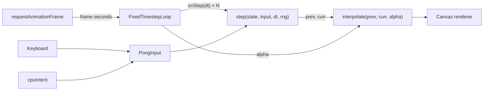

# 001 — Fixed-Timestep Pong

> Pong whose physics run at a constant rate no matter how fast your monitor refreshes, rendered smoothly with interpolation.

**Stack:** TypeScript + Canvas · **Level:** Starter · **Track:** Foundations

## What it is

A complete Pong game against a CPU opponent. Press keys 1–4 to change the simulation rate (10, 20, 60, or 120 Hz) while you play, and press I to toggle interpolation. At 10 Hz with interpolation off, the ball visibly stutters. With interpolation on, it moves smoothly even though the physics only update ten times a second.

```
 ┌──────────────────────────────────────┐
 │        3     ┊     2                 │
 │ █            ┊                       │
 │ █            ┊          ■            │
 │ █            ┊                     █ │
 │              ┊                     █ │
 │              ┊                     █ │
 │ sim 60 Hz · steps/frame 1 · interp on│
 └──────────────────────────────────────┘
```

## Gaming technique: the fixed-timestep loop

The naive game loop calls `update(dt)` once per frame with a variable `dt`. That makes physics depend on frame rate: collisions get missed on slow frames, and replays and networked games drift apart.

This project uses the accumulator pattern from Glenn Fiedler's *Fix Your Timestep*:

1. Each frame, add the real elapsed time to an **accumulator**.
2. While the accumulator holds at least one step, run `update(STEP)` and subtract `STEP`.
3. The leftover fraction, `alpha = accumulator / STEP`, tells the renderer how far it is between the last two simulation states. The renderer **interpolates** between them.
4. Clamp each frame's time (`maxFrameSeconds`) to avoid the **spiral of death**, where one slow frame demands more steps, which causes a slower next frame.

Other details from shipped games:
- **Angle-by-impact bounces:** hitting the ball with the paddle edge sends it off steeper, which gives the player control.
- **Swept paddle collision:** the ball is tested for *crossing* the paddle face during a step, so it can't tunnel through at top speed.
- **Snap on teleport:** interpolation is skipped when the ball resets after a point, so it doesn't smear across the screen.

## Software engineering concepts

- **Functional core, imperative shell.** `src/core/` is pure TypeScript with no DOM access. `step(state, input, dt, rng)` returns a new immutable state. `src/main.ts` is the only file that touches the browser.
- **Dependency injection of time and randomness.** The loop receives time through `advance()` instead of calling `performance.now()`. The simulation receives a seeded RNG. Both choices make tests deterministic.
- **Determinism as a tested property.** A test plays 20 simulated seconds fed by 240 Hz frames and by jittery 30 Hz frames, then asserts that the final states are identical.
- **Immutable snapshots.** Because states are never mutated, keeping `prev` and `curr` for interpolation is just two references, with no copying.
- **Explicit state machine.** `phase` is a closed union (`serving | playing | gameOver`) handled by an exhaustive `switch`.
- **Input as intent.** The core sees `-1 | 0 | 1` per paddle, not key codes. A human, the CPU, or a replay can drive either paddle.

**Trade-offs**
- Interpolation renders up to one step behind the newest simulation state, which adds a little latency. Extrapolation avoids that but mispredicts on bounces.
- Allocating a new state object every step is fine at this scale. A game with thousands of entities would use mutable, double-buffered arrays instead.
- The frame clamp makes the game slow down under heavy load rather than skip ahead. That is the right call for single-player, but not for a networked game.

## Architecture



## Build, run, and test

```bash
npm install
npm run dev     # play at http://localhost:5173
npm test        # 21 unit tests (Vitest)
npm run build   # typecheck + production bundle
```

## Project structure

```
src/
├── core/
│   ├── loop.ts         # fixed-timestep accumulator loop
│   ├── pong.ts         # pure game rules and state
│   ├── interpolate.ts  # render-side blending between snapshots
│   ├── ai.ts           # CPU paddle
│   └── rng.ts          # seedable PRNG (mulberry32)
└── main.ts             # browser shell: input, rAF, canvas drawing
tests/
├── loop.test.ts        # step counts, alpha, clamping, rate changes
└── pong.test.ts        # serving, bouncing, tunneling, scoring, determinism
```

## Possible extensions

- Record inputs per step and add replay playback (see project 005)
- Two-player local mode and gamepad support (see project 002)
- Online play using the same deterministic core
- Visual juice: screen shake on hits, ball trails
