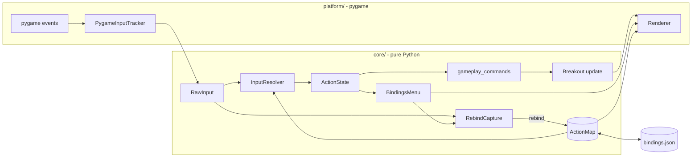

# 002 — Input Action Mapping

> Breakout where the game never sees a key code: keyboard and gamepad input flow through a rebindable action layer that the player can remap in-game.

**Stack:** Python + pygame · **Level:** Starter · **Track:** Foundations

## What it is

A complete Breakout game (60 bricks, 3 lives, speed-up per brick, angle-by-impact paddle) that plays with a keyboard, a gamepad's stick or D-pad, or both at once. Press **F1** (or the gamepad's Back button) to open the controls menu, pick an action, and press any key, button, or stick direction to bind it. Bindings are saved to a JSON file and loaded on the next launch. All on-screen prompts ("Space / Btn 0 to launch") are generated from the live bindings, so they update when you rebind.

```
 ┌──────────────────────────────────────────┐      ┌──────────────────────────────────────────┐
 │ SCORE 120                        LIVES 3 │      │                CONTROLS                  │
 │ ▬▬▬ ▬▬▬ ▬▬▬ ▬▬▬     ▬▬▬ ▬▬▬ ▬▬▬ ▬▬▬ ▬▬▬  │      │        Gamepad: Xbox Controller          │
 │ ▬▬▬ ▬▬▬     ▬▬▬ ▬▬▬ ▬▬▬ ▬▬▬     ▬▬▬ ▬▬▬  │      │  Move Left    Left, A, Stick 0-, D-pad.. │
 │ ▬▬▬ ▬▬▬ ▬▬▬ ▬▬▬ ▬▬▬ ▬▬▬ ▬▬▬ ▬▬▬ ▬▬▬ ▬▬▬  │  F1  │ ▌Launch       Space, Btn 0              │
 │                                          │ ───► │  Pause        P, Btn 7                   │
 │                 ■                        │      │  ...                                     │
 │                                          │      │  Reset to defaults                       │
 │            ▀▀▀▀▀▀▀▀                      │      │  Waiting for input... 4s                 │
 │   Move Left/Right   Pause P   Controls F1│      │  Press a key, button, or stick for Launch│
 └──────────────────────────────────────────┘      └──────────────────────────────────────────┘
```

## Gaming technique: input action mapping

Hard-coding `if key == K_SPACE: launch()` works until you need a second device, a left-handed layout, an accessibility remap, or a different meaning for the same key on another screen. Every major engine solves this the same way: Unreal's Enhanced Input, Unity's Input System, and Godot's InputMap all put a layer of **actions** between devices and gameplay.

```
 physical source          action            game command
 ───────────────          ──────            ────────────
 key:left      ─┐
 key:a         ─┼──►  MOVE_LEFT  ─┐
 pad:axis:0:-  ─┤                 ├──►  move = right − left ∈ [-1, 1]
 pad:hat:0:left─┘                 │
 key:right ... ───►  MOVE_RIGHT ─┘
 key:space     ─┬──►  LAUNCH     ───►  launch (edge)
 pad:button:0  ─┘
```

How it works here:

1. **Sources** name physical controls without any library types: `Key("space")`, `PadButton(0)`, `PadAxis(0, -1)` (the left half of stick X), `PadHat(0, "up")`. They serialize as short strings like `pad:axis:0:-`.
2. The **action map** is many-to-many: several sources per action, and the same source may drive different actions in different **contexts** (Space is Launch in gameplay and Confirm in the menu). Inside one context, a source drives at most one action.
3. Each frame the **resolver** reads a raw snapshot and produces, per action, an analog `value`, a digital `held`, and `just_pressed` / `just_released` **edges**. Analog sticks get a **rescaled deadzone** (so values start at 0 just past the deadzone instead of jumping to 0.2) and **hysteresis** (press at 0.5, release at 0.35) so a stick resting near the threshold doesn't chatter.
4. **Rebinding** uses a capture prompt that ignores whatever was already held when it opened. Otherwise the Enter/A press used to open the prompt would bind itself. If the new source was used by another action in that context, it **moves** and the menu says so ("Moved from Launch"), warning if that leaves an action unbound.

Shipped games add the same refinements: per-device "slots" in the controls menu, context stacks (vehicle vs. on-foot), and glyphs that follow the last-used device.

## Software engineering concepts

- **Ports and adapters.** `core/` defines its own input vocabulary (`RawInput`). `platform/pygame_input.py` is the only adapter that knows pygame events. Swapping pygame for another library, or feeding recorded input, means writing another adapter. Nothing in `core/` imports pygame.
- **Layered translation with one job per layer.** Devices → `RawInput` (tracker) → `ActionState` (resolver) → `Commands` (`gameplay_commands`) → `Breakout.update`. The game only knows `Commands(move, launch, toggle_pause)`, so an AI, replay, or network peer can drive it directly.
- **Data-driven configuration.** Bindings are data: `to_dict()`/`from_dict()` and a versioned JSON file. Missing actions fall back to defaults, so old bindings files keep working when new actions ship. Saving is **atomic** (temp file + `os.replace`). A corrupt file means defaults plus a visible warning, never a crash.
- **Explicit state machines.** The capture prompt (`WAITING → CAPTURED | CANCELLED | TIMED_OUT`) and the controls menu are pure classes fed `(ActionState, RawInput, dt)`, which makes the whole rebind flow testable without a window.
- **Injected time and randomness.** `Breakout` takes a `random.Random` and receives `dt`. The capture timeout counts down by `dt`, not the wall clock. A test plays 3,000 frames twice with the same seed and asserts identical results.
- **Invariants enforced at the boundary.** `ActionMap` rejects same-context conflicts on construction, and `rebind()` preserves the invariant by moving sources rather than duplicating them. `GameConfig` and `ResolverConfig` validate themselves.
- **Robust collision through sub-stepping.** The ball moves in steps no longer than its half-size, so even a long frame at max speed can't tunnel through a brick. A 20,000-frame soak test with random frame times checks that the ball always stays in bounds.

**Trade-offs**
- Rebinding replaces *all* of an action's bindings for that device class (keyboard or gamepad), so remapping Move Left to J drops both Left and A. Per-slot bindings would be more flexible but need a bigger menu.
- Moving a conflicting source on rebind is friendlier than refusing, but can silently unbind an action. The menu shows a warning, and menu navigation itself is not rebindable, so the player can't lock themselves out.
- Edges come from one shared held-set across all contexts. That is what stops Escape (Back in the menu, Quit in gameplay) from closing the menu *and* quitting on the next frame. The cost is that a key held during a screen switch never fires on the new screen until it is pressed again, which is almost always what players want.
- All connected pads merge into one virtual pad. That's right for a single-player game. Local multiplayer would need per-player maps keyed by device.
- Variable `dt` with a frame clamp (1/20 s) keeps the shell simple. See project 001 for a fixed-timestep loop.

## Architecture



## Build, run, and test

```bash
python -m venv .venv && source .venv/bin/activate
pip install -e ".[dev]"

breakout-actions                         # or: python -m breakout
breakout-actions --seed 42 --bindings ./my-bindings.json

pytest                                    # 100 tests; core needs no display
```

Default controls: **←/→ or A/D** or left stick or D-pad to move, **Space**/A button to launch, **P**/Start to pause, **F1**/Back for controls, **Esc** to quit. Bindings are stored in `$XDG_CONFIG_HOME/breakout-actions/bindings.json` (default `~/.config/...`). The platform smoke tests run pygame with SDL's dummy video driver, so they also pass headless.

## Project structure

```
src/breakout/
├── core/
│   ├── actions.py      # Action and Context enums; which actions are rebindable
│   ├── bindings.py     # Source types, ActionMap, rebind rules, defaults, (de)serialization
│   ├── resolver.py     # RawInput -> ActionState: deadzone, hysteresis, edges
│   ├── capture.py      # "press a key" prompt state machine
│   ├── menu.py         # controls menu state machine
│   ├── commands.py     # ActionState -> game Commands (the seam)
│   └── breakout.py     # game rules: paddle, ball, bricks, lives, sub-stepped collision
├── platform/
│   ├── pygame_input.py # pygame events -> RawInput (hot-plug, focus loss)
│   ├── renderer.py     # procedural drawing, binding-aware prompts
│   └── app.py          # main loop, screen switching, CLI
├── persistence.py      # versioned, atomic JSON load/save
└── __main__.py
tests/                  # bindings, resolver, capture, menu, commands, game, persistence, headless smoke
```

## Possible extensions

- Per-slot bindings (primary/secondary per device) and composite chords (Shift+Click)
- Device-aware glyphs: show keyboard or gamepad prompts based on the last device used
- Local two-player mode with one action map per player, assigned by device
- Record `Commands` per frame for replays (see project 005)
- A context stack so overlays (pause, dialogs) can consume actions before gameplay sees them
