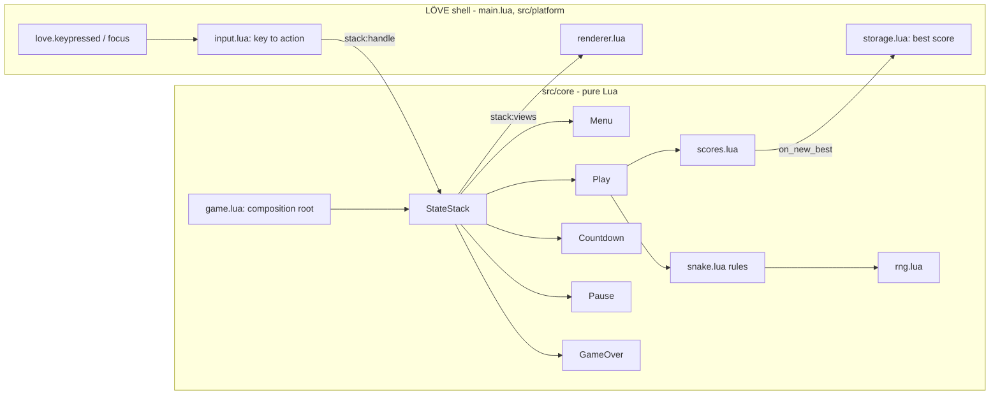
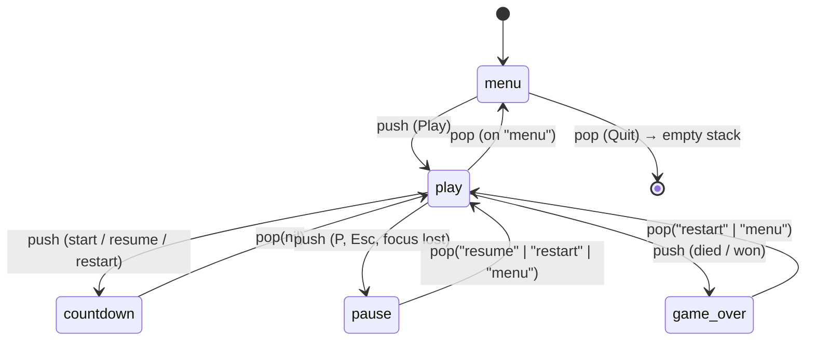

# 003 — Stack-Based State Machine

> Snake whose menu, countdown, pause and game-over screens live on a pushdown automaton: opening a screen pushes it, closing it pops back to exactly where you were.

**Stack:** Lua + LÖVE · **Level:** Starter · **Track:** Foundations

## What it is

A complete Snake game for LÖVE 11: a 24×18 board, buffered turns, speed-up as you eat, a win condition when the board is full, and a saved best score. The point of the project is the screen flow. Every screen is a state on a stack, and the stack decides who updates, who receives input and who gets drawn. Press **F3** in-game to see the live stack.

```
 stack: menu > play > pause               What gets drawn (bottom → top)
 ┌──────────────┐
 │ pause        │ transparent  ──────►  PAUSED overlay
 ├──────────────┤
 │ play         │ opaque       ──────►  frozen board (no update, no input)
 ├──────────────┤
 │ menu         │ hidden       ──────►  not drawn at all
 └──────────────┘
```

| Screen | Pushed by | Pops with | Flags |
|--------|-----------|-----------|-------|
| `menu` | boot | nothing (an empty stack quits) | opaque |
| `play` | menu "Play" | when told to go back to the menu | opaque |
| `countdown` | play on start, restart, and resume | `nil` after 3 s | transparent |
| `pause` | play on P / Esc / focus loss | `"resume"`, `"restart"`, `"menu"` | transparent |
| `game_over` | play on death or a full board | `"restart"`, `"menu"` | transparent |

## Gaming technique: the pushdown automaton

A flat state machine holds one current state: `MENU → PLAYING → PAUSED → PLAYING`. That breaks down as soon as screens nest. A pause menu has to remember which state it interrupted, a confirm dialog can open over the pause menu, and an options screen may be reachable from both the title and the pause menu and has to return to whichever one opened it. Encoding every "return to X" as its own transition makes the transition table explode.

A **pushdown automaton** adds a stack. Opening a screen *pushes* it and suspends the screen below instead of destroying it. Closing it *pops* and resumes the screen below with all of its state intact. The stack is the history, so an overlay never needs to know who opened it. This project adds two ideas on top that most shipped implementations also use:

- **Pop results.** `stack:pop("restart")` hands a value to the state below via `resume(result)`. Pause and Game Over never touch the round. They report the player's choice and `play` decides what it means, the same way a function returns a value to its caller.
- **Per-state flags.** `transparent` makes the renderer draw the state below too (overlays over a frozen board). `update_below` lets a state keep the one below simulating (a non-blocking toast or HUD). Input always goes to the top state only.

The same pattern appears in Game Programming Patterns' *State* chapter ("pushdown automata"), in the screen managers of the XNA/MonoGame samples, in Unity and Godot UI navigation stacks, and in almost every console game's menu stack.

Snake itself uses two small techniques worth noting:

- **Turn buffering.** Turns are queued (up to 2) and validated against the last *queued* direction, so a fast "up, left" between ticks performs both moves, and no sequence of taps can reverse the snake into its own neck.
- **Tick accumulator with a catch-up cap.** The snake moves on a grid at a speed that rises with score. Elapsed `dt` accumulates and pays for whole moves, and a long frame can buy at most `max_steps_per_update` moves, so a hitch never teleports the snake into a wall.

## Software engineering concepts

- **Deferred commands.** Transitions requested while the stack is busy (inside `update`, `handle`, or a lifecycle hook) are queued and applied afterwards, in request order. This removes a whole class of bugs where a state keeps running after it popped itself or the iteration skips a state. A guard aborts after 64 transitions in one commit, so two states that bounce each other forever fail loudly instead of hanging.
- **Template-method lifecycle.** `enter`, `exit`, `pause`, `resume`, `update`, `handle` and `view` are all optional, so a state implements only what it needs, like the 30-line `countdown`.
- **Views as plain data.** States return `{ kind = "play", body = ..., score = ... }` instead of drawing. The core never calls `love.*`, and `platform/renderer.lua` is the only module that knows how a view looks. That is what makes the whole screen flow testable with plain `busted`.
- **"Empty stack means quit."** Quitting is not a global flag. The title menu pops itself, and the shell exits when nothing is left.
- **Composition root.** `core/game.lua` builds the config, seeded RNG, scores and stack. The LÖVE shell and the tests both start from it, so they run the same game. Persistence comes in as an injected `on_new_best` callback.
- **Injected time and randomness.** Every update takes `dt`, and food placement uses an injected MINSTD RNG whose products stay below 2^53, so a seed yields the same game on LuaJIT, Lua 5.1 and Lua 5.4. A test replays 600 frames of scripted input twice and compares the outcome.
- **Validated configuration.** `core/config.lua` rejects unknown keys, wrong types and impossible values (such as `min_tick > base_tick`) at startup.

**Trade-offs**
- Deferring transitions means a state that pops itself still finishes the current call. That is the intended behaviour, but code after `stack:pop()` must not assume the state is already gone.
- Pop results are strings. That keeps them simple, but a typo is only caught by tests, not by the language. A larger game would use constants or small result tables.
- A stack only models nesting. Screens that are siblings (tabs in an options menu) or that run in parallel (a HUD layer next to gameplay) fit better as a separate state machine per layer.
- Food placement scans the board for free cells, which costs O(cols × rows) per meal. That's trivial at 24×18. A huge board would keep a free-cell set instead.

## Architecture





## Build, run, and test

```bash
# install: LÖVE 11.x (https://love2d.org) and busted (Lua test runner)
luarocks install busted          # or: apt install love lua-busted

# run
love .                           # or: make run
love . 12345                     # fixed RNG seed

# test (core logic, headless, no LÖVE needed)
busted                           # 51 tests
make test-all                    # same suite on LuaJIT, Lua 5.1 and Lua 5.4

# package a .love file into build/
make love
```

Controls: **Arrows/WASD** to steer and navigate menus, **Enter/Space** to select, **P** to pause, **Esc** for back/pause (quits from the title), **F3** to show the state stack. Losing window focus pauses a round automatically. The best score is saved in LÖVE's save directory for `stack-snake`.

## Project structure

```
main.lua                 # LÖVE callbacks: input in, views out, quit on empty stack
conf.lua                 # window and module config
Makefile                 # run / test / test-all / love
.busted                  # test runner config (adds src/ to the module path)
src/
├── core/
│   ├── state_stack.lua  # the pushdown automaton: lifecycle, deferred transitions, views
│   ├── game.lua         # composition root: config + rng + scores + stack
│   ├── snake.lua        # rules: tick accumulator, turn buffer, growth, food, win
│   ├── config.lua       # defaults and validation
│   ├── rng.lua          # seeded MINSTD generator
│   ├── scores.lua       # last/best score
│   ├── menu_list.lua    # wrapping menu cursor shared by every menu screen
│   └── states/          # menu, play, countdown, pause, game_over
└── platform/
    ├── input.lua        # LÖVE key names -> abstract actions
    ├── renderer.lua     # procedural drawing per view kind
    └── storage.lua      # best-score file via love.filesystem
tests/
├── state_stack_spec.lua # lifecycle order, pop results, deferral, flags, errors
├── snake_spec.lua       # movement, buffering, collisions, wrap, win, determinism
├── flow_spec.lua        # end-to-end screen flow through the real states
└── support_spec.lua     # rng, config, menu list, scores, key mapping
```

## Possible extensions

- An options screen reachable from both the title and pause menus, to show that it returns to whichever one opened it without extra code
- A confirm dialog ("Quit to menu? Your round will be lost") pushed over the pause menu
- Animated push/pop transitions (slide or fade) driven by a transition state (see project 004)
- Gamepad support through the action layer from project 002
- Record actions per frame for replays, using the seeded RNG (see project 005)
