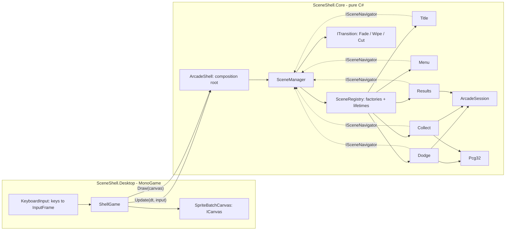
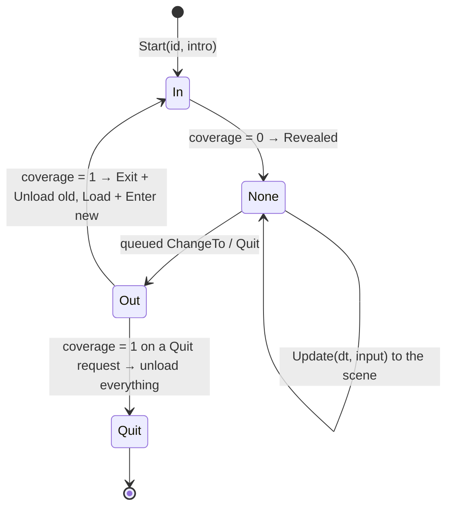

# 004 — Scene Manager & Transitions

> A tiny arcade (title, menu, two mini-games and a results card) where every screen is a scene with lifecycle hooks, and every change between them is a covered fade or wipe that swaps scenes at the moment the screen is fully hidden.

**Stack:** C# + MonoGame · **Level:** Starter · **Track:** Foundations

## What it is

A MonoGame DesktopGL app rendered at 320×180 and scaled up with crisp pixels. There are no asset files: every shape and every letter is a rectangle drawn in code.

- **Title**: a starfield that keeps scrolling while the screen fades. "PRESS ENTER" only appears once input is live.
- **Menu**: pick **DODGE**, **COLLECT** or **QUIT**. The menu is a *persistent* scene, so after a round the cursor is still on the game you played, and its visit counter keeps going up.
- **Dodge**: slide along the floor and avoid falling blocks that spawn faster and fall harder the longer you survive. Dying dips the screen to dark red.
- **Collect**: catch gems for 30 seconds. Three misses end the round early.
- **Results**: score and best, then **Enter** to play the same game again or **Esc** for the menu.

Press **F3** at any time to see the manager's state machine live: current scene, phase, coverage and queued requests.

```
  Title ──fade──► Menu ──wipe──► Dodge ───red flash──► Results ──wipe──► same game again
    │   ◄──fade──  │ ▲  ◄──fade── (Esc)                    │
   Esc             │ └────────────────fade─────────────────┘
    ▼              └──wipe──► Collect ──fade──► Results
   quit (fade)     Menu "QUIT" fades out and quits too

 one change, over time (0.35 s out + 0.35 s in):

 coverage 1 ┤          ████
            │        ██    ██          Out: old scene drawn, cover grows
            │      ██        ██        ── swap at coverage 1 ──
            │    ██            ██      In:  new scene drawn, cover shrinks
 coverage 0 ┼████                ████  input reaches scenes only here (idle)
            idle   Out  ▲swap  In  idle
```

## Gaming technique: the scene manager

Almost every game is a collection of screens. A **scene manager** owns the one that is current, routes `Update` and `Draw` to it, and moves to another when asked. The interesting parts are *when* things happen during a change:

1. **Lifecycle hooks.** Each scene gets `Load → Enter → Revealed → Update/Draw… → Exit → Unload`. Splitting `Load`/`Unload` (allocate, once per instance) from `Enter`/`Exit` (every visit) is what makes persistent scenes possible: the menu is built once and keeps its state, while each Dodge round is a fresh instance, so "play again" needs no reset code.
2. **Swap under cover.** A transition has an *Out* half (cover grows over the old scene) and an *In* half (cover shrinks off the new one). The manager swaps scenes exactly when coverage reaches 1. The player never sees a half-initialised scene, and in a real game the expensive `Load` would hide behind that opaque frame. This is why loading screens and "dip to black" cuts are everywhere, from Zelda's room transitions to Celeste's level wipes.
3. **Input lockout.** Nothing receives input while a transition runs. Mashing Enter during a fade can't select a menu item twice, and a scene that is leaving can't react to a keypress.
4. **Opt-in background updates.** A scene can set `UpdatesDuringTransition` so it keeps animating while covered, like the title starfield. It still gets no input.
5. **`Revealed` hook.** Fires when the cover is gone, the moment the scene becomes interactive. The title uses it to show its prompt only when pressing Enter will actually do something.

The transitions themselves are stateless descriptions: the manager owns the clock and passes in `coverage ∈ [0,1]` and the phase. The **fade** uses a smoothstep curve for its alpha so it eases in and lands softly. The **wipe** uses ease-in-out-cubic and keeps moving in the same direction across the swap (the bar grows from the left, then leaves through the right) instead of reversing, which reads as one continuous motion.

## Software engineering concepts

- **Deferred requests (command queue).** `ChangeTo` and `Quit` only enqueue. The manager starts a change after the current call returns, so a scene can ask to leave from inside its own `Update` or `Enter` and still finish that call safely. Requests made during a transition wait their turn in FIFO order.
- **Explicit state machine.** The manager is a three-state machine (`None → Out → In → None`) driven by a single `Pump(time)` loop. The loop lets one long frame pass through several phases, carries leftover time from the fade-out into the fade-in, and completes zero-length transitions (`CutTransition`) instantly.
- **Fail loudly.** Two scenes that change to each other on entry with zero-length transitions would spin forever inside one frame, so the manager aborts after 16 swaps in one update. Unknown scene ids fail at the `ChangeTo` call site rather than seconds later at swap time, and a factory returning null, negative or NaN `dt`, double `Start` and use after quit all throw with clear messages.
- **Interface segregation.** Scenes see `ISceneNavigator<TId>` (`ChangeTo`, `Quit`), not the manager. They can ask to leave, but they can't drive another scene's lifecycle.
- **Registry + factories + lifetimes.** `SceneRegistry<TId>` maps ids to factories and a `Transient`/`Persistent` lifetime. Scenes are built lazily, only when the player goes there. The manager is generic over the id type, so it knows nothing about this arcade.
- **Strategy pattern for transitions.** `ITransition` is `OutDuration`, `InDuration` and `Draw(canvas, coverage, phase)`. Fade, wipe and cut are interchangeable, and each change picks its own: menus fade, games wipe, death flashes red.
- **Simulation separated from presentation.** `SceneShell.Core` has no MonoGame reference. It draws through a one-method `ICanvas` (`FillRect`), with text built from rectangles by a 3×5 bitmap `PixelFont`. The MonoGame host implements `ICanvas` with a SpriteBatch and a 1×1 white texture. Tests use a `RecordingCanvas` that logs every rectangle.
- **Shared session instead of scene-to-scene coupling.** Games write their result to `ArcadeSession`. The results screen reads it on `Enter`, so it works for any game without knowing who sent the player there.
- **Composition root.** `ArcadeShell` builds the config, session, transitions, registry and manager. The desktop host and the tests construct the same shell and run the same game.
- **Injected time and randomness.** Everything takes `dt`, and long frames are clamped to 0.1 s before they reach the simulation. Spawns use an injected PCG32 whose output is checked against the reference sequence from pcg-random.org, so a seed reproduces the same round on every platform (`System.Random` makes no such promise). A test plays two scripted Dodge rounds with the same seed and compares scores.
- **Validated configuration.** `ArcadeConfig` is an immutable record. `Validate()` rejects non-positive durations, inverted ranges (`MaxBlockSize < MinBlockSize`) and bodies wider than the screen, and names the bad setting.

**Trade-offs**
- *One scene at a time.* This manager replaces scenes. It doesn't stack them. Overlays like a pause menu fit better on a pushdown stack (project 003), and many engines combine the two: a scene manager for whole screens and a stack inside each scene for menus.
- *FIFO queue vs. "latest wins".* Queuing every request is predictable and easy to test, but a scene that calls `ChangeTo` twice in one update plays both changes back to back. Some engines drop all but the newest request instead. Input lockout makes the double request rare here.
- *Synchronous `Load`.* Swapping under cover hides a slow load for at most one frame. A game with big levels would make `Load` asynchronous and hold the cover at 1 until loading finishes, which is a small extension of the same state machine.
- *Stateless transitions.* Passing coverage in keeps transitions shareable and their drawing a pure function, but it rules out effects that need memory, like a dissolve that samples the previous frame. Those need a snapshot of the old scene in a render target.
- *Rectangles only.* The `ICanvas` abstraction is deliberately tiny so the core stays portable and testable. A bigger game would add sprites, and the interface would grow with them.
- *Offline test harness.* The test project normally uses xUnit. For machines without NuGet access it can instead compile against a small (about 280 lines) in-repo stand-in that mirrors the xUnit API it uses. That shim is a maintenance cost: any new xUnit assertion used in a test also has to be added to it.

## Architecture





## Build, run, and test

```bash
# install: .NET 8 SDK (https://dot.net). MonoGame comes from NuGet on first build.

# run (opens a 1280×720 window)
dotnet run --project src/SceneShell.Desktop
dotnet run --project src/SceneShell.Desktop -- 12345      # fixed RNG seed

# test (core logic only, headless, 69 tests)
dotnet test tests/SceneShell.Core.Tests

# test without NuGet access: same test files, in-repo xUnit stand-in
OfflineHarness=true dotnet run --project tests/SceneShell.Core.Tests
OfflineHarness=true dotnet run --project tests/SceneShell.Core.Tests -- Wipe   # filter by name
```

Controls: **Arrows/WASD** move and navigate, **Enter/Space** confirm, **Esc/Backspace** back (quits from the title), **F3** debug overlay. Unfocusing the window drops held keys.

**What was verified for this commit:** the core library and the full suite (69 tests) were built and run with the offline harness on .NET 8 in a Linux sandbox without NuGet access. The MonoGame host couldn't be restored there, so it was type-checked against a stub of the MonoGame API surface it uses, but not compiled against the real package or run. `dotnet test` with real xUnit and `dotnet run` on the desktop host need a machine with NuGet access.

## Project structure

```
SceneShell.sln
Directory.Build.props            # net8.0, nullable, C# 12 for every project
src/
├── SceneShell.Core/             # no MonoGame reference
│   ├── Scenes/
│   │   ├── Scene.cs             # lifecycle hooks: Load, Enter, Revealed, Update, Draw, Exit, Unload
│   │   ├── SceneManager.cs      # the transition state machine, deferred queue, swap under cover
│   │   ├── SceneRegistry.cs     # id → factory + Transient/Persistent lifetime
│   │   └── ISceneNavigator.cs   # what scenes are allowed to ask for
│   ├── Transitions/             # ITransition, Fade, Wipe, Cut, easing curves
│   ├── Input/InputFrame.cs      # abstract actions, held + pressed-this-frame
│   ├── Rendering/               # ICanvas, Rgba, 3×5 PixelFont
│   ├── Randomness/Pcg32.cs      # seeded, platform-stable RNG
│   └── Arcade/
│       ├── ArcadeShell.cs       # composition root
│       ├── ArcadeConfig.cs      # validated tunables
│       ├── ArcadeSession.cs     # scene ids, results, best scores
│       ├── ArcadeTheme.cs       # palette and the shared transitions
│       ├── Playfield.cs         # Box, Faller, Paddle
│       └── Scenes/              # Title, Menu, Dodge, Collect, Results
└── SceneShell.Desktop/          # MonoGame DesktopGL host
    ├── Program.cs               # seed parsing, run
    ├── ShellGame.cs             # Game subclass: input in, low-res render target out
    ├── KeyboardInput.cs         # key bindings + edge detection
    └── SpriteBatchCanvas.cs     # ICanvas via a 1×1 white texture
tests/SceneShell.Core.Tests/
├── SceneManagerTests.cs         # hook order, deferral, coverage, input lockout, lifetimes, queue, quit, errors
├── TransitionTests.cs           # easing endpoints, fade alpha, wipe spans, validation
├── ArcadeFlowTests.cs           # end-to-end flow through the real scenes, determinism
├── SupportTests.cs              # PCG32 reference vector, font, input edges, session, config
├── TestDoubles.cs               # RecordingCanvas, RecordingScene, StubTransition
└── OfflineHarness/              # xUnit stand-in + reflection runner (offline mode only)
```

## Possible extensions

- Asynchronous `Load`: hold the cover at full coverage until a loading task completes, with a progress bar drawn by the transition
- More transitions: an iris circle closing on the player, a pixelate dissolve, or a slide that pushes the old scene off-screen (needs a render-target snapshot of the old scene)
- A pause overlay stack inside the game scenes, combining this manager with project 003's pushdown automaton
- Gamepad bindings through the action layer from project 002
- Record each round's `InputFrame`s and replay them with the same seed (see project 005)
- Save best scores to disk through an injected storage interface
