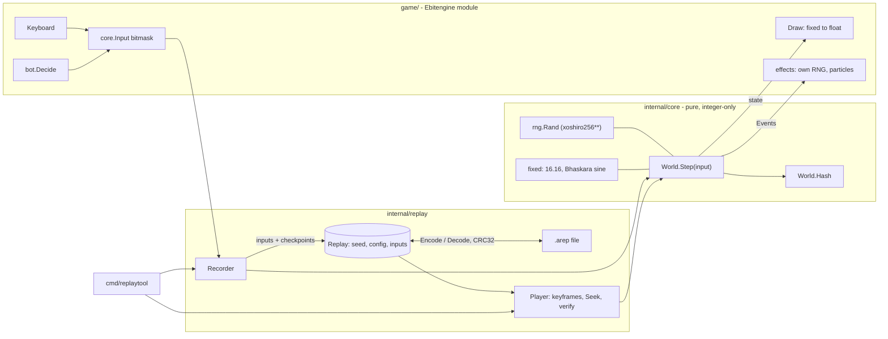

# 005 — Deterministic RNG & Replays

> Asteroids whose entire game can be rebuilt, frame for frame, from a seed and a log of key presses: a two-minute game fits in about 4 KB.

**Stack:** Go + Ebitengine · **Level:** Intermediate · **Track:** Foundations

## What it is

A complete Asteroids game: thrust and turn on a wrapping playfield, split rocks large → medium → small, survive waves that grow each round. Every run is being recorded. Press **P** at any time (or **Enter** after game over) for an instant replay, scrub back and forth with the arrow keys, play it at 1–8× speed, step tick by tick, and press **F5** to save it as an `.arep` file you can reopen later with `-replay`.

The replay doesn't store positions, rocks or bullets. It stores the RNG seed, the gameplay config, and one byte of input per tick. Playback re-runs the simulation and checks a state hash every second. If a single bit of state ever disagrees with the recording, playback stops and reports the exact tick where it desynced.

A headless `replaytool` records bot-played demos, verifies replays and draws any tick as ASCII. This is tick 2400 of `replaytool demo -seed 7`:

```
+----------------------------------------------------------------+
|                                          o        o            |
|                                           O                    |
|                                                  O             |
|                                                     o          |
|                                            o                   |
|          o                                   @                 |
|                                                         @      |
|                                                                |
|                                            v                   |
|                                  o                             |
+----------------------------------------------------------------+
tick 2400  score 2540  lives 3  wave 2   (empty rows trimmed; @ O o rocks, v ship)
```

## Gaming technique: deterministic lockstep simulation

If a game is a pure function of its inputs, you don't need to save the game. Saving the inputs is enough. Doom's `.lmp` demos, StarCraft and Age of Empires replays, Rocket League and Trackmania ghosts, fighting-game rollback netcode, and speedrun tool-assisted runs all rely on this. It's also how RTS games keep thousands of units in sync over the network: every client runs the same simulation and only commands are exchanged.

Making a game *actually* deterministic takes several deliberate choices:

1. **Fixed timestep.** Each `Step` is exactly 1/60 s, and every duration is counted in ticks. There is no `dt` to vary between runs. Ebitengine's `Update` already runs at a fixed TPS, so one `Update` is one tick (see project 001 for the accumulator loop behind that).
2. **A seeded RNG that the code owns.** Rock spawns, split angles, spins and outlines all come from `xoshiro256**` in `internal/rng`, seeded through SplitMix64. Its algorithm is pinned in this repository, and tests check it against the reference vectors and freeze the first outputs for a known seed, so a library or Go upgrade can't silently change the sequence and break every saved replay.
3. **The RNG is part of the state.** `rng.Rand` is a plain value inside `World`, so cloning the world clones the generator. That is what makes snapshots and seeking possible.
4. **No floating point in the simulation.** Positions and velocities are 16.16 fixed-point integers. Headings are "binary degrees" (256 per turn, wrapping for free in a `uint8`). Sine comes from a lookup table built with Bhaskara I's integer approximation, not `math.Sin`. The reason: Go may fuse `x*y + z` into a single FMA instruction on arm64, ppc64 and s390x but not on amd64, and the two round differently. A float simulation recorded on an Intel laptop can desync on an ARM Mac. Integer math can't.
5. **Stable iteration order.** Entities live in slices, collisions are resolved in slice order, and fragments are added after the collision pass. There are no maps in the simulation, because Go randomizes map iteration on purpose.
6. **Cosmetics use a separate RNG.** Particles and stars draw from their own clock-seeded generator in the shell. If explosions consumed gameplay randomness, turning particles off would change the next asteroid split. The simulation emits `Events` for the renderer, and those events are excluded from the hash.
7. **Checkpoints catch desyncs early.** The recorder stores a 64-bit FNV-1a hash of the full state every 60 ticks. Without them a desync shows up minutes later as "the ship flew into a rock for no reason". With them you get `replay desynced at tick 1260`, and everything up to tick 1200 is known good.

## Software engineering concepts

- **Functional core, imperative shell.** `internal/core` imports only `fixed` and `rng`: no Ebitengine, no files, no clock. The `game/` module reads keys, calls `Recorder.Step`, and draws whatever `World` contains. The clock is read exactly once, in `main`, to choose a seed.
- **Single entry point for state changes.** During live play, input reaches the world only through `Recorder.Step`, so the recording can't miss anything the player did. Playback goes through `Player.Step`, which verifies checkpoints as it goes.
- **Memento pattern for seeking.** Input replays can't jump to tick N without simulating ticks 0..N-1. `Player` caches a `World.Clone()` keyframe every five seconds as playback passes it, so seeking restores the nearest earlier keyframe and simulates at most five seconds (about 9 µs for a backward seek on a 1-minute replay, see benchmarks).
- **Versioned, validated binary format.** `.arep` is a little-endian header (magic, version, seed, the whole `Config` struct via `encoding/binary`), run-length-encoded inputs as uvarints, checkpoints, and a CRC32 trailer. Replays are untrusted input, so `Decode` checks magic, version, checksum, config validity, undefined input bits, run lengths, checkpoint order, size limits and trailing bytes, and returns a typed error for each (`errors.Is(err, replay.ErrChecksum)`).
- **Typed errors for diagnosis.** A desync is a `*DesyncError{Tick, Want, Got}`, not a string, so the game can pause on the exact tick and `replaytool verify` can exit with a distinct status code (3) for CI-style determinism checks.
- **Configuration travels with the data.** The replay embeds the `Config` it was recorded under, so retuning `DefaultConfig` doesn't break old files. A test proves that a replay played back with a different `BulletSpeed` desyncs.
- **Bot as just another input source.** `internal/bot` reads the `World` and returns an `Input`, exactly like the keyboard. It drives the tests, `replaytool demo` and the in-game autopilot (**B**), so long, eventful games can be tested with no human involved.
- **Behaviour-level tests.** 50 tests cover the RNG against reference vectors, Bhaskara error bounds, wrap-seam collisions, splitting and scoring, respawn safety, game over, identical hashes for 5000-tick runs, round trips, desync detection at the right checkpoint, seek equivalence with linear playback, and every malformed-file case.

**Trade-offs**

- *Inputs vs. state snapshots.* Input logs are tiny and exact, but they tie a replay to one version of the simulation. Any change to rules, step order or RNG usage invalidates old files. The format version and the frozen RNG test make that failure loud instead of silent. Games that need replays to survive patches (or that are too complex to keep deterministic) record state snapshots instead, at 100× the size.
- *Fixed point vs. floats.* Fixed point gives exact results everywhere, but it has a limited range (±32768) and coarse precision (1/65536), and you have to watch for overflow. `LenSq` returns raw 64-bit values for that reason. Shipped games also make floats deterministic with strict compiler flags and avoid transcendental functions, which is workable in C++ but harder to guarantee in Go.
- *Keyframe interval.* Denser keyframes make seeking faster but cost memory (each is a full world copy). Five seconds is cheap here because a world is a few kilobytes.
- *Checkpoint density.* One hash per second adds 12 bytes per second to the file in exchange for locating a desync within 60 ticks. Tests or debug builds could checkpoint every tick.
- *Mutable `Step`.* The world mutates in place, which is simple and allocation-light, so snapshots need an explicit deep `Clone`. Project 001's immutable states make snapshots free but allocate every tick.
- *Offline build.* Ebitengine couldn't be downloaded in the environment this project was generated in, so `game/` is a separate Go module. The root module has no dependencies, and `go test ./...` there runs everything that matters headlessly. The front end was type-checked against stubs of the Ebitengine API it uses. Build it on a machine with network access as shown below.

## Architecture



## Build, run, and test

Requires Go 1.22+.

```bash
# core, replay system and CLI (no dependencies)
go test ./...                       # 50 tests
go test ./internal/replay -bench .  # simulation and seek benchmarks
go run ./cmd/replaytool demo -seed 7 -seconds 120 -o demo.arep
go run ./cmd/replaytool verify demo.arep      # OK: 7200 ticks, 120 checkpoints matched ...
go run ./cmd/replaytool frame -tick 2400 demo.arep

# the game window (downloads Ebitengine on first run)
cd game
go mod tidy                         # fetches Ebitengine and writes go.sum
go run .                            # play
go run . -replay ../demo.arep       # watch the bot's game
go run . -seed 42 -autopilot        # attract mode
```

On Linux, Ebitengine needs the usual X11 and OpenGL headers, for example `sudo apt install libc6-dev libgl1-mesa-dev libxcursor-dev libxi-dev libxinerama-dev libxrandr-dev libxxf86vm-dev libasound2-dev pkg-config`. macOS and Windows need nothing extra.

**Controls.** Live: arrows/WASD fly, Space fires, P instant replay, F5 save, R new seed, B autopilot, Esc quit. Playback: Space pause, `.` single step, ←/→ seek 5 s, 1–4 speed, Home restart, F5 save, Esc new game. The four boxes in the top-right light up with the recorded inputs for the current tick.

Benchmarks on the generation machine: re-simulating and verifying a full minute of play takes about 1 ms (over 50,000× faster than real time), and a backward seek takes about 9 µs.

## Project structure

```
go.mod                      # root module: simulation, replay, CLI (no deps)
internal/
├── fixed/                  # 16.16 fixed point, binary-degree angles, Bhaskara sine table, vectors
├── rng/                    # xoshiro256** + SplitMix64 seeding, snapshot-able value type
├── core/                   # Asteroids rules: World, Step, Clone, Hash, Config, events
├── bot/                    # integer-only autopilot used by tests, demo and attract mode
└── replay/                 # .arep format, Recorder, Player (keyframes, Seek, desync check)
cmd/replaytool/             # headless demo / info / verify / frame commands
game/                       # separate module: Ebitengine window, input, drawing, particles
├── go.mod
├── main.go                 # flags, seeds, window setup
├── game.go                 # live and playback modes, saving, keyboard mapping
├── draw.go                 # procedural vector rendering, wrap ghosts, HUD and timeline
└── effects.go              # cosmetic particles and starfield on their own RNG
```

Go keeps tests next to the code they test (`*_test.go` in each package).

## Possible extensions

- **Ghost racing:** play a saved replay translucently alongside a live game, as Trackmania does
- **Rollback netcode:** two clients on localhost exchange inputs; on a late input, restore the last confirmed keyframe and re-simulate (project territory for the networking track)
- **Desync bisection:** on a checkpoint mismatch, re-record with per-tick hashes and dump a field-by-field diff of the first differing tick
- **Cross-platform check:** run `replaytool verify` on amd64 and arm64 and compare the final hashes
- **Compression:** follow the RLE with DEFLATE (`compress/flate`) for long sessions
- **Kill-cam:** keep a ring buffer of the last 5 seconds of keyframes and replay the moment of death automatically
