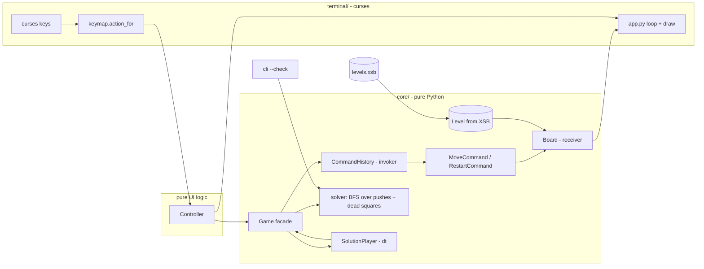

# 006 — Command Pattern Undo

> Terminal Sokoban where every move is a command object, so you get unlimited undo/redo, an undoable restart, solver hints, and a checker that proves every level can be solved.

**Stack:** Python · **Level:** Starter · **Track:** Foundations

## What it is

A complete Sokoban game for the terminal (curses, standard library only) with six original levels. Push every box (`[]`) onto a goal (`··`). Boxes on goals turn into `{}`.

```
 5/6  Crossroads
moves 6  pushes 2  goals 1/4  undo 6  redo 0

  ██████████████
  ██··  ██    ██
  ██  @@[]    ██
  ██{}    []··██
  ██      []  ██
  ██    ██  ··██
  ██████████████

Still solvable in 10 pushes.

Move: arrows/WASD/hjkl  z undo  y redo  r restart  ? hint  c check  p solve  n/b level  q quit
```

- **z / y**: undo and redo with no limit. Undo all the way back, then redo all the way forward.
- **r**: restart. It is a command too, so **z** right after a restart brings your position back.
- **c**: check. The solver tells you whether the position is still winnable ("Deadlocked: no solution from here. Undo!").
- **?**: hint. Plays the next move of an optimal solution. Hints are ordinary moves, so you can undo them.
- **p**: auto-play the rest of the level, one step every 0.12 s. Any key takes back control.
- `sokoban-undo --check` solves every level in a collection and exits non-zero if one can't be solved. It works as a level-design lint.

## Gaming technique: undo through the command pattern

Puzzle games treat undo as a core mechanic: *Baba Is You*, *Stephen's Sausage Roll*, and *Snakebird* all let you rewind every step, because experimenting has to be cheap for a puzzle to be fun. Level editors, strategy games (turn rewind), and every creative tool ship the same feature.

The simple approach is to save a full copy of the game state before every move. That works for tiny states but wastes memory, and it gives you nothing to show or replay. The **command pattern** turns each action into an object that knows how to `execute()` itself and how to `undo()` itself:

```
            execute(cmd)                    undo()                     redo()
 undo: [m1 m2 m3]  ──►  [m1 m2 m3 m4]  ──►  [m1 m2 m3]       ──►  [m1 m2 m3 m4]
 redo: [ ]              [ ]                 [m4]                  [ ]
                         ▲ a new command clears the redo stack: that future no longer exists
```

This project uses both undo strategies, side by side:

| Command | How undo works | Cost per step |
|---|---|---|
| `MoveCommand` | **Inverse operation.** It stores its direction and whether it pushed a box. Undo steps back and pulls the box. | A few bytes |
| `RestartCommand` | **Memento.** A restart can't be reversed from the command alone, so it saves a `Snapshot` of the board first. | One full snapshot |

Commands also make the move log free. `history.notation()` prints standard LURD notation (lowercase = walk, uppercase = push). The solution checker replays a LURD string through the same `MoveCommand`, so the game and the checker can never disagree about the rules.

### The level solver

Sokoban is PSPACE-complete, but small levels fall to a well-chosen search:

1. **Search over pushes, not steps.** Walking without touching a box never changes what's possible. So a node is *(box layout, the region the player can reach)*, and the region is reduced to its smallest cell. That merges thousands of equivalent player positions into one node, and breadth-first search returns a **push-optimal** solution.
2. **Dead-square pruning.** Before searching, it "pulls" boxes backward from every goal. Any floor cell no pull can reach (most corners, and walls with no goal) is dead. A push onto a dead square is never generated, and a position with a box already on one is rejected with no search at all.
3. **Budgeted.** The search stops after `max_states` (default 200,000) and reports `GAVE_UP` rather than freezing the game.

| Level | Positions searched | Time (CPython 3.13) |
|---|---:|---:|
| Two Rooms | 601 | ~25 ms |
| Crossroads | 1,125 | ~40 ms |
| Warehouse | 6,635 | ~270 ms |

## Software engineering concepts

- **Command pattern (receiver / command / invoker).** `Board` is the *receiver*. It has only basic operations (`place_player`, `move_box`) and no rules. `MoveCommand` and `RestartCommand` are the *commands*. `CommandHistory` is the *invoker*. Because every change to the board goes through `history.execute`, hints, auto-play, and restarts get undo without any extra code.
- **Execute-then-record.** `CommandHistory.execute` runs the command *before* pushing it. An illegal move raises `IllegalMoveError` and never enters history, so the undo stack holds only commands that really ran.
- **Memento** for the restart command, using the same `Snapshot` type the tests use to compare whole board states.
- **Façade.** `Game` gives the UI one small surface (`move`, `undo`, `hint`, `check`, `next_level`) and hides history, the solver, and plan caching. The hint keeps the remaining solution while the player follows it and searches again only when they leave the planned line.
- **Pure core, thin shell.** `core/` has no I/O, terminal, or clock. `terminal/controller.py` turns UI actions into game calls and messages, and is pure as well. Only `terminal/app.py` imports curses. Time is passed in: `SolutionPlayer.update(dt)` uses an accumulator, so playback speed doesn't depend on frame rate, and tests drive it with exact numbers.
- **Property-based thinking with a seeded RNG.** For 20 seeds, a test plays 300 random legal moves, restarts, and undos. It then checks that undoing everything returns to the exact start, and that redoing the same number of steps gives back the exact end position.
- **Validation at the boundary.** `parse_level` rejects bad levels with precise messages (wrong player count, box/goal mismatch, unknown symbols with line and column, a level not enclosed by walls, boxes outside the playable area). The CLI turns those messages into exit code 2. `--check` returns 1 when a level can't be solved.
- **Performance where it matters.** The solver numbers its cells with integers and uses a neighbour table instead of hashing `Pos` tuples. That made it about 10× faster than the first `Pos`-based version. A stress test keeps the full bundled set under a time limit.

**Trade-offs**

- **Inverse vs. snapshot undo.** Inverse commands are cheap but each command must be exactly reversible. A bug there corrupts state quietly, which is why the randomized round-trip test exists. Snapshots are simple and always correct but cost memory on every step. Using a snapshot only for restart gets both benefits.
- **Linear history.** A new move after undo throws away the redo branch, like most games. An undo *tree* (as in Vim or Emacs) keeps every branch but needs a UI to move between them.
- **`--history-limit`** caps memory for very long sessions. The cost is that the oldest moves become permanent, and `notation()` can't replay from the start any more.
- **Search quality.** Dead squares catch single-box deadlocks only. Two boxes frozen against each other are still found, but only by exhausting the search, which is fine at this size. Larger levels need freeze/corral deadlock detection and A* with a matching-based heuristic.
- **Hint optimality.** Solutions are optimal in *pushes*, not total moves, the usual choice for Sokoban solvers. The walks between pushes are shortest paths, but a different push order might walk less.

## Architecture



## Build, run, and test

```bash
python -m venv .venv && source .venv/bin/activate
pip install -e ".[dev]"            # no runtime dependencies; pytest for dev

sokoban-undo                       # or: python -m sokoban (best at 100x24 or larger)
sokoban-undo --level 5 --history-limit 500
sokoban-undo --levels my-pack.xsb  # any XSB collection, levels separated by blank lines

sokoban-undo --check               # solve every level, print LURD solutions; exit 1 if any is unsolvable

pytest                             # 96 tests, including a real curses run through a pseudo-terminal
```

On Windows, Python has no `curses` module: `pip install windows-curses` first. The pseudo-terminal smoke test is skipped there, and the rest of the suite still runs.

## Project structure

```
src/sokoban/
├── core/
│   ├── geometry.py     # Pos, Direction (with LURD letters)
│   ├── level.py        # immutable Level, XSB parser, validation
│   ├── board.py        # mutable receiver: player, boxes, counters, Snapshot memento
│   ├── commands.py     # Command protocol, MoveCommand (inverse undo), RestartCommand (memento)
│   ├── history.py      # CommandHistory: undo/redo stacks, optional limit, LURD log
│   ├── solver.py       # dead squares, push-optimal BFS, solution checker
│   ├── game.py         # Game facade, hint plan cache, SolutionPlayer (dt-driven)
│   └── render.py       # Board -> XSB text
├── terminal/
│   ├── keymap.py       # key names -> Action
│   ├── controller.py   # Action -> game calls + status messages (no curses)
│   └── app.py          # curses loop, colors, drawing
├── data/levels.xsb     # six original CC0 levels
├── resources.py        # load bundled or user level files
└── cli.py              # argparse entry point, --check report
tests/                  # level, commands/history, solver, game, controller/CLI, terminal smoke
```

## Possible extensions

- Undo tree with a branch picker, so no line of play is ever lost
- Merge commands into "macro moves" (click a cell to walk there, drag a box) that undo as one step
- Freeze and corral deadlock detection, then A* with a minimum-matching heuristic for bigger levels
- Save and resume: write `history.notation()` to disk and replay it on load
- A level editor whose edits are commands as well, checked with `--check` before saving
