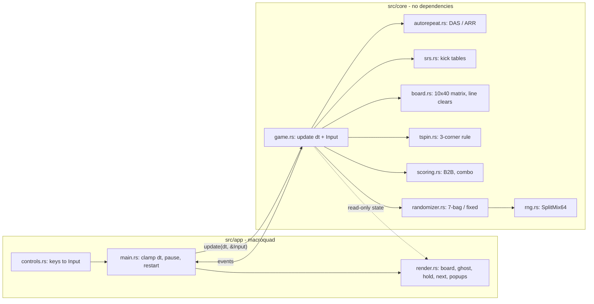

# 007 — Tetris with SRS

> Modern-feeling Tetris: Super Rotation System wall kicks, a 7-bag randomizer, lock delay with move resets, hold, DAS/ARR and T-spin detection, all in a dependency-free Rust core.

**Stack:** Rust + macroquad · **Level:** Intermediate · **Track:** Foundations

## What it is

A complete, playable falling-block game that follows the rules of the modern Tetris Guideline: a 10×40 matrix (20 visible rows), ghost piece, five-piece preview, hold, Guideline gravity and scoring, back-to-back and combo bonuses, and the two official top-out conditions. When you score, the clear is named for you ("B2B T-SPIN DOUBLE  COMBO x2"), and the active piece darkens as its lock delay runs out.

```
   HOLD        ┌──────────────────────────┐      NEXT
  ┌──────┐     │                          │      ▬▬▬▬
  │  ▄█▄ │     │          ▄█▄             │       ▀█▄
  └──────┘     │                          │      ▄▄█
               │                          │       ██
  SCORE        │                          │      █▄▄
  14 250       │          ┌┐              │
  LEVEL 3      │ ▓▓   ▓▓ ┌┘└┐   ▓▓▓▓▓▓    │   ←/→ move
  LINES 27     │▓▓▓▓ ▓▓▓▓▓  ▓▓ ▓▓▓▓▓▓▓    │   ↓ soft · Space hard
               │▓▓▓▓▓▓▓▓▓▓ ▓▓▓▓▓▓▓▓▓▓    │   ↑/X cw · Z ccw · C hold
               └──────────────────────────┘
                     T-SPIN DOUBLE  +1200
```

Everything on screen is drawn with rectangles and lines: no textures, no external assets.

## Gaming technique

Tetris looks simple, but the version people play today is a stack of carefully tuned rules. Each one exists to make the game fair and the controls feel responsive.

**Super Rotation System (SRS).** Every piece rotates about the centre of a fixed bounding box (4×4 for I, 2×2 for O, 3×3 for the rest). If the rotated piece would overlap a wall or the stack, SRS tries four alternative offsets, or "kicks", in a fixed order and uses the first that fits. J, L, S, T and Z share one kick table; the I piece has its own because its box rotates about a point between cells. Kicks are why you can rotate a piece hugging the wall, and why a T can twist into a slot under an overhang. `src/core/srs.rs` holds the official tables, and a test checks that every A→B row is the exact negation of B→A, which catches transcription errors.

**7-bag randomizer.** Pieces come from a shuffled bag of all seven. A uniform random generator can go 30 pieces without an I; with a bag the worst drought is 12 and you never see more than four S/Z pieces in a row. Tests verify the drought bound over 70 000 pieces.

**Lock delay and "extended placement".** A grounded piece doesn't lock at once: you get 0.5 s to slide or rotate it. Every successful move or rotation on the ground resets that timer, but only 15 times per piece, so you can't stall forever. Reaching a new lowest row refills the 15 resets, so a piece you're working downward isn't punished. Tetris DS, Puyo Puyo Tetris and Tetris 99 all work this way.

**DAS and ARR.** Holding a direction moves once, waits for the Delayed Auto Shift (167 ms), then repeats at the Auto Repeat Rate (33 ms per column; 0 means "teleport to the wall"). If both directions are held, the most recent wins. Competitive players tune these two numbers more than any other setting.

**T-spin detection (three-corner rule).** A lock is a T-spin when the piece is a T, its last *successful* action was a rotation, and at least three of the four cells diagonal to its centre are blocked (walls and floor count). It's a full T-spin when both corners on the side the T points toward are blocked; otherwise it's a mini. The exception: if the rotation used SRS's fifth kick test, it always counts as full. That rule is what makes the T-spin triple possible.

**Scoring.** Guideline values times the level: single 100, double 300, triple 500, Tetris 800, T-spin single/double/triple 800/1200/1600. "Difficult" clears (Tetrises and line-clearing T-spins) chain into back-to-back for ×1.5. Consecutive clearing locks add a combo bonus of 50 × combo × level. Soft drop scores 1 per row, hard drop 2.

**Gravity.** Seconds per row is `(0.8 − (level − 1) × 0.007)^(level − 1)`: one row per second at level 1, about one row per frame by level 15.

**Top-out.** *Block out* happens when a new piece spawns overlapping the stack. *Lock out* happens when a piece locks entirely above the visible 20 rows.

## Software engineering concepts

- **Functional core, imperative shell.** `src/core` has no dependencies and no I/O. `Game::update(dt, &Input)` is the only way time passes, randomness arrives through the `RandomSource` trait, and the renderer only reads state. The macroquad layer in `src/app` is about 450 lines that map keys to `Input`, call `update`, and draw.
- **Feature-gated presentation.** macroquad is an optional dependency behind the default `gui` feature, and the binary has `required-features = ["gui"]`. `cargo test --no-default-features` builds and tests the core with zero third-party crates, so the compiler itself enforces that the core never imports the renderer.
- **Strategy pattern for randomizers.** `Game` takes a `Box<dyn Randomizer>`. `SevenBag` is the default. `FixedSequence` deals a scripted order, which makes the integration tests readable ("deal a T, then an I") and also serves puzzle or tutorial modes. A classic NES-style or history-based randomizer would be another implementation.
- **Data-driven rules.** Kick tables are `const` data, not branches. Rotation states 1–3 are derived from the spawn state by a quarter-turn formula instead of being typed in, so there are 7 shapes to get right rather than 28.
- **Events instead of callbacks.** `update` pushes `Event::Scored`, `LevelUp`, `Held` and `GameOver` into a queue that the shell drains each frame to show popups. The core never calls into the presentation layer.
- **Validated configuration.** `Config` holds lock delay, reset limit, DAS, ARR, soft-drop factor, preview count and level settings. `Game::new` validates it and returns a typed `ConfigError`, so the simulation never has to guard against NaN or negative timings mid-game.
- **Edge vs. held input.** `Input` separates held states (left, right, soft drop) from per-frame presses (rotate, hard drop, hold). The shell decides what a press is, so OS key repeat can't leak into the game and DAS stays entirely in the core where it can be tested.
- **Tests at three levels.** 53 tests: unit tests next to each module (shapes, kicks, scoring, DAS timing, config), behaviour tests driving `Game` through real input (a T-spin double played from spawn scores 1200; lock resets run out after 15; a new low refills them; both top-outs), and a stress suite that mashes random input through 200 games while checking every frame that the active piece never overlaps the stack and that cells are conserved (`filled = 4 × pieces − 10 × lines`). The same suite replays a 30 000-frame session twice and requires identical boards.

**Trade-offs**

- *y-up coordinates.* The matrix uses row 0 at the bottom so the kick tables can be copied verbatim from the Guideline. The renderer flips y. The alternative (screen-space y-down) would mean negating every table entry, which is a classic source of SRS bugs.
- *Floating-point time.* `dt` is an `f64` in seconds, which keeps the API natural for a variable-rate shell. The simulation is still deterministic for a given input stream (the stress test proves it), but recordings wouldn't be portable across different frame rates. Project 005 shows the integer-tick alternative used for replays and lockstep netcode.
- *Lock-delay policy.* After the 15 resets are spent, this implementation lets the timer keep running however much the player wiggles. Some games instead lock the instant the piece touches down again. Both prevent infinite stalling; this one is a little more forgiving.
- *Boxed trait objects.* `Box<dyn Randomizer>` and `Box<dyn RandomSource>` cost one indirect call per piece, which is negligible, and keep `Game` free of generic parameters that would otherwise spread into the renderer.
- *Single crate vs. workspace.* One crate with an optional feature is simpler to build than a two-crate workspace. The cost is that the binary's modules live in the same `src/` tree, so the boundary is enforced by the feature flag rather than a crate boundary.

## Architecture



## Build, run, and test

```bash
# run the game (needs a desktop; on Linux, X11/Wayland + OpenGL)
cargo run --release
cargo run --release -- --seed 42     # reproducible piece order

# test the pure core only: no third-party crates are compiled
cargo test --no-default-features

# test everything, including a compile of the macroquad front end
cargo test

# lint
cargo clippy --all-targets
```

All 53 tests pass. macroquad compiles headlessly, and the game was also launched under a virtual X display to check the rendering.

## Project structure

```
Cargo.toml              # `gui` feature (default) pulls in macroquad
src/
├── lib.rs
├── core/               # pure simulation
│   ├── piece.rs        # shapes, rotation states, derived rotations
│   ├── board.rs        # matrix, collisions, line clears, ASCII fixtures
│   ├── srs.rs          # kick tables and try_rotate
│   ├── tspin.rs        # three-corner rule, mini vs full
│   ├── scoring.rs      # Guideline points, back-to-back, combos
│   ├── autorepeat.rs   # DAS / ARR
│   ├── randomizer.rs   # Randomizer trait, SevenBag, FixedSequence
│   ├── rng.rs          # RandomSource trait, SplitMix64
│   ├── config.rs       # validated tuning, gravity curve
│   └── game.rs         # update loop, lock delay, hold, spawn, top-out
└── app/                # macroquad shell
    ├── main.rs
    ├── controls.rs
    └── render.rs
tests/
├── common/mod.rs       # helpers: scripted games, taps
├── game.rs             # movement, gravity, lock delay, hold, levels, top-out
├── tspin.rs            # T-spin double played from spawn, fifth-kick upgrade
├── randomizer.rs       # bag permutation, drought bound, uniformity
└── stress.rs           # random-input invariants and determinism
```

## Possible extensions

- 180° rotation with its own kick table (as in Tetris 99 and TETR.IO)
- Perfect-clear (all-clear) bonus and an "ALL CLEAR" popup
- Garbage lines and a 40-line sprint or 2-minute ultra mode
- Input recording on a fixed tick for replays (see project 005)
- ARE (entry delay) and line-clear delay with an animation
- A bot that searches placements with SRS kicks to find T-spin setups
