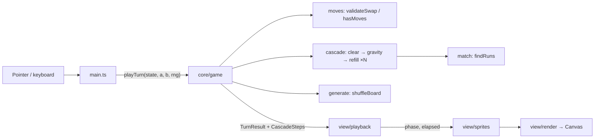

# 008 — Match-3 Board Engine

> A complete match-3 engine: legal-swap validation, chained cascades with gravity and refill, and automatic reshuffles when the board runs out of moves.

**Stack:** TypeScript + Canvas · **Level:** Starter · **Track:** Foundations

## What it is

A playable match-3 game on an 8×8 board. Click two neighboring gems or drag one onto a neighbor to swap them. Swaps that don't make a line of three bounce back. Matched gems clear, everything above falls under constant gravity, new gems drop in from the top, and any new lines cascade with a rising score multiplier. If a turn leaves no legal move, the board reshuffles itself. Idle for six seconds (or press H) and the best move is highlighted.

Every gem is drawn procedurally, and each color has its own silhouette (circle, square, diamond, triangle, hexagon, star), so the board stays readable for color-blind players.

```
 score 180          chain ×2
 ┌────────────────────────┐
 │ ▲ ◆ ★ ⬢ ■ ▲ ■ ▲        │   swap ▲(6,2) ↔ ■(6,3)
 │ ★ ◆ ■ ★ ⬢ ■ ■ ▲        │   → column 6 gets ■■■ (rows 0–2)
 │ ⬢ ⬢ ● ◆ ★ ● ▲ ●        │     and ▲▲▲ (rows 3–5)
 │ ■ ● ■ ⬢ ▲ ● ■ ★        │   → both clear, column refills,
 │ ◆ ⬢ ■ ◆ ● ■ ▲ ▲        │     refill makes a new line,
 │ ■ ▲ ◆ ■ ⬢ ★ ▲ ■        │     chain ×2 doubles its points
 └────────────────────────┘
```

## Gaming technique: the match-3 turn

A turn in Bejeweled, Candy Crush, or Puzzle Quest is a small pipeline:

1. **Swap validation.** A swap is legal only if the two gems are orthogonal neighbors *and* the result has a run of 3+ through at least one of them. The check only scans the row and column through each swapped cell (`isMatchedAt`), so it costs O(width + height), not a full board scan.
2. **Match detection.** One linear pass per row and per column finds maximal runs. Runs of 4 and 5 are reported as single runs (so they can earn bonuses), and an L or T shape is two runs that share a corner, which is cleared once.
3. **Clear → gravity → refill.** Matched cells become holes. Each column is compacted bottom-up with a write cursor (one O(height) pass that keeps gem order), and the holes left at the top are filled with random gems stacked *above* the board so they fall in as a column.
4. **Cascades.** Refills can create new runs, so the pipeline repeats until the board is stable. Each pass is a "chain" and multiplies its points. This is where most of the excitement in match-3 games comes from.
5. **No-moves detection and reshuffle.** After every turn the engine checks that a legal move exists (early-exit scan of every right and down swap). If not, it shuffles the *same* gems with Fisher–Yates until the board has no matches and at least one move. If that gem mix can never work, it falls back to a new board.

Board generation avoids free matches by construction: cells are filled left-to-right, top-to-bottom, and each cell forbids the color that would complete a run with the two cells to its left or above. That rules out at most two colors, so with three or more colors there is always a legal pick, and no rejection sampling is needed for matches. The board is only regenerated if it happens to have no moves.

Animation follows real physics: falling gems accelerate (`d = ½·g·t²`), so a gem falling four rows lands later than one falling one row, which is what makes cascades read as weight rather than tweens.

## Software engineering concepts

- **Simulation resolves instantly, presentation replays it.** `playTurn` runs the whole turn in one call and returns a `TurnResult` with every `CascadeStep` (runs, cleared cells, drops, spawns, before/after boards). The view never re-derives rules; it just animates the log. The game is never in a half-resolved state, so there are no animation-timing bugs in the rules.
- **Immutable boards.** Every operation returns a new `Board`. Steps can hold references to `before` and `after` boards with no copying, and tests can compare snapshots directly.
- **Result types instead of exceptions for player errors.** An illegal swap returns `{ ok: false, reason }` with a closed union (`out-of-bounds | not-adjacent | empty-cell | no-match`). Exceptions are reserved for real bugs or bad configuration: invalid `Match3Config`, or a cascade that never settles (`maxCascades`).
- **Injected randomness.** Generation, refill, and shuffle all take an `Rng`. Tests use scripted RNGs to force exact refills (including a chain reaction and a dead board), and a seeded replay test proves the same seed and moves give the same game.
- **Pure view logic, thin shell.** `view/playback.ts` (timed phase queue, driven by `dt`) and `view/sprites.ts` (phase + time → sprite list) have no DOM access and are unit-tested. Only `view/render.ts` and `main.ts` touch the canvas.
- **Text fixtures.** `fromRows(["AAB", "C.A"])` builds boards from strings, which keeps tests readable and makes bug reports reproducible.

**Trade-offs**
- Resolving the whole turn up front means the player can't act mid-cascade. Some modern games let you swap while gems are still falling. That needs a per-cell "settled" state and incremental resolution, which is far more complex.
- Allocating a new board per operation is trivial at 64 cells. A 100×100 board with particles would use a mutable typed array.
- The hint picks the swap that clears the most gems right now. It ignores cascades, because they depend on random refills, and it doesn't plan ahead.
- The fallback when a shuffle can't succeed changes the gem mix. That is rare on real boards but it is a visible rule bend.

## Architecture



## Build, run, and test

```bash
npm install
npm run dev     # play at http://localhost:5173 (add ?seed=42 for a fixed board)
npm test        # 44 unit tests (Vitest)
npm run build   # typecheck + production bundle
```

Controls: click or drag to swap · H shows a hint · R restarts the same seed · N starts a new seed.

## Project structure

```
src/
├── core/
│   ├── board.ts     # immutable grid, positions, text fixtures
│   ├── config.ts    # Match3Config + validation
│   ├── match.ts     # run detection and per-cell match checks
│   ├── moves.ts     # swap validation, move search, no-moves detection
│   ├── cascade.ts   # clear, gravity, refill, scoring, cascade loop
│   ├── generate.ts  # match-free generation and Fisher–Yates reshuffle
│   ├── game.ts      # turn API: playTurn, newGame, hint
│   └── rng.ts       # seedable PRNG (mulberry32)
├── view/
│   ├── playback.ts  # dt-driven animation phase queue
│   ├── sprites.ts   # phase + time → sprites (pure)
│   └── render.ts    # procedural gem shapes on canvas
└── main.ts          # browser shell: input, rAF, HUD
tests/
├── board.test.ts    # fixtures, config, runs, swap validation, dead boards
├── engine.test.ts   # gravity, refill, cascades, generation, shuffle, turns, 1000-turn soak
└── playback.test.ts # phase mapping, bounce, timing, constant-acceleration falls
```

## Possible extensions

- Special gems: a run of 4 makes a line-clearer, an L/T makes a bomb, a run of 5 makes a color bomb
- Level goals and move limits (clear N red gems in 20 moves), loaded from JSON
- Blockers such as ice, chains, and holes in the board shape, which change gravity rules
- Diagonal slide-in refill for irregular boards
- An AI that looks ahead through expected cascades (Monte Carlo over refills)
