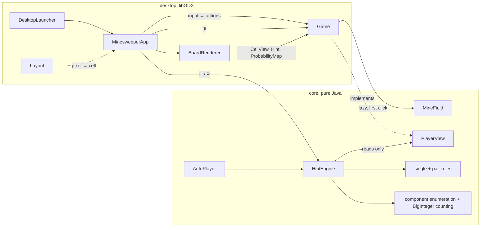

# 009 — Minesweeper with Hint Solver

> Classic Minesweeper with a first click that is always safe, an iterative flood fill, and a hint button that explains its reasoning. It proves cells safe or mined from the visible numbers, and when nothing can be proven it gives the exact odds for each cell.

**Stack:** Java + libGDX · **Level:** Starter · **Track:** Foundations

## What it is

A desktop Minesweeper drawn entirely with shapes: bevelled tiles, flags, mines, a seven-segment mine counter and timer, and the face button. Press **H** for a hint. The target cell is outlined (green for safe, red for a mine, amber for a guess or a wrong flag), the numbers that prove it are outlined in blue, and a sentence explains why. Press **P** for an odds overlay that tints every hidden cell from green to red by its exact mine probability.

```
 ┌─────────────────────────────┐
 │ 010         ☺          014  │   mine counter · face (new game) · timer
 ├─────────────────────────────┤
 │  ▓ ▓ ▓                      │   The classic 1-2-1 against a wall. The solver's chain:
 │  1 2 1                      │   1. PAIR    (col 3, row 1) is a mine:
 │  · · ·                      │      "The 1 at (col 1, row 2) allows at most 1 mine in the cells it
 │                             │       shares with the 2 at (col 2, row 2). The 2 still needs 2, so
 └─────────────────────────────┘       its other 1 undecided neighbor must be a mine."
                                   2. SINGLE  (col 2, row 1) is safe: the right-hand 1 is now satisfied
                                   3. SINGLE  (col 1, row 1) is a mine: the left-hand 1 has one cell left
```

## Gaming technique

### First-click safety without moving mines

Older versions moved a mine away if the first click landed on it. This version does not place mines at all until the first reveal. `MineField.generate` then excludes the clicked cell and its 3×3 neighbourhood, so the first click is always a 0 and opens a region. If the board is too dense for that, only the clicked cell is excluded. Mines are picked with a partial Fisher–Yates shuffle over the allowed cells: exactly `mines` random draws, every layout equally likely, and no rejection loop.

### Flood fill

Opening a 0 opens all its neighbours, and every neighbour that is also a 0 keeps the fill going. `Game.floodOpen` is a breadth-first search over a preallocated `int[]` queue. A cell is marked open *before* it is queued, so each cell is visited at most once. Recursion would overflow the stack on a large empty board; the test suite opens a 100×100 board with one click. Flags stop the fill, as in the original game.

### Constraint-based hints

Every open number is a constraint: *exactly n of these hidden neighbours are mines*. The `HintEngine` tries cheap techniques first and only moves on when they find nothing:

1. **Single number.** If a number already touches n proven mines, its other neighbours are safe. If it needs k more mines and has exactly k undecided neighbours, they are all mines. This repeats until nothing changes, because each deduction can unlock more.
2. **Pairs.** For two numbers A and B that share cells, A alone limits the shared cells to between `lo` and `hi` mines. If B needs no more than `lo`, B's other cells are safe. If B needs `hi` plus all of its other cells, they are mines. This covers the subset rule and the classic 1-2 and 1-2-1 wall patterns.
3. **Enumeration.** Count every mine layout that fits all the numbers *and the total mine count*, and look for cells that are safe or mined in every layout. This catches end-game deductions that only the mine counter can prove.
4. **Best guess.** If nothing is provable, suggest the cell with the lowest exact mine probability.

The enumeration step is efficient because it doesn't search the whole board at once:

- **Frontier vs. interior.** Only cells next to a number (the frontier) need searching. Interior cells carry no information, so with `r` mines left for `I` interior cells there are exactly C(I, r) ways to fill them.
- **Independent components.** Frontier cells that share no number can't affect each other. Each component is enumerated on its own with pruned backtracking, giving a count of valid assignments for each mine count k.
- **Convolution.** The per-component counts are combined by polynomial multiplication, then weighted by C(I, M − t) for the interior. One search over 2^(a+b) layouts becomes two searches of 2^a and 2^b.

Player flags are deliberately **not trusted**. The solver reasons from numbers alone, so if the player flags a cell that is provably safe, the hint says *"The flag at … is wrong"* instead of building later deductions on the mistake.

Auto-playing with only the hints (`gradle :core:simulate -Pgames=1000`, center first click, seeds 1–1000):

| Level | Win rate | Guesses / game | ms / game |
|-------|---------:|---------------:|----------:|
| Beginner (9×9, 10) | 95.9% | 0.15 | 0.6 |
| Intermediate (16×16, 40) | 87.0% | 0.47 | 3.2 |
| Expert (30×16, 99) | 46.8% | 2.81 | 17.4 |

Every loss comes from a forced guess, never from a cell the solver called safe. The tests check this across hundreds of full games.

## Software engineering concepts

- **Information hiding by interface.** The solver depends only on `PlayerView`: open cells, their numbers, flags and the mine total. It cannot see `MineField`, so it can't cheat even by accident. The same interface lets tests build positions directly from text (`Position.of("o*f", "ooo")`) instead of playing into them.
- **Sealed hint hierarchy.** `Hint` is a sealed interface (`FirstClick`, `Deduction`, `WrongFlag`, `Guess`). The renderer and the auto-player use exhaustive pattern-matching `switch`es, so adding a hint type is a compile error everywhere it isn't handled yet.
- **Exact arithmetic where correctness depends on it.** Layout counts use `BigInteger`. C(480, 240) has 144 digits, and "probability is exactly 0" must be an integer comparison, not `p < 1e-9`. Doubles appear only in the probabilities shown to the player.
- **Cheapest technique first, with explanations.** The rules run in order of cost, and each deduction records its rule, evidence cells and a sentence. Hints read like a player's reasoning ("this 2 already touches 2 mines") rather than "the solver says so".
- **Bounded work.** Enumeration has a node budget. On a pathological position the engine falls back to a local density estimate (`Guess.exact() == false`) instead of freezing the frame.
- **Injected time and randomness.** `Game.tick(dt)` is the only way time passes, and the desktop shell clamps frame time to 0.25 s so a stalled window doesn't jump the clock. Mine placement takes a `RandomGenerator`, so a seed always reproduces the same board for the same first click.
- **Core/presentation split.** `core` has no libGDX dependency. `desktop` only maps input to `reveal`/`toggleFlag`/`chord` and draws `CellView`s, and `CellView` only shows mines once the game is over.
- **Property and oracle tests.** Beyond hand-made positions, the tests compare enumeration against brute force on 120 random positions (all 2ⁿ layouts) and replay hundreds of full games, checking every hint against the hidden layout.

**Trade-offs**
- Each hint recomputes from scratch. That is simple and stateless, and fast enough (under 20 ms for a whole expert game), but an incremental solver would scale to much larger boards.
- Guesses only minimise the immediate mine probability. Stronger solvers also weigh how much information a reveal is likely to give, which adds a few points on Expert.
- The pair rule only compares numbers within two cells of each other. Wider reasoning is left to enumeration, which subsumes it at higher cost.
- Not trusting flags means a correct flag is "re-proven" on every hint. That is cheap here and makes wrong-flag detection possible.

## Architecture



## Build, run, and test

Requires JDK 21 and Gradle 8.x (no wrapper is committed; run `gradle wrapper` once if you prefer `./gradlew`).

```bash
gradle :core:test                       # 40 unit, property and full-game tests (JUnit 5)
gradle :core:simulate -Pgames=1000      # solver win rates per difficulty
gradle :desktop:run                     # play (beginner, random seed)
gradle :desktop:run --args="--level=expert --seed=42"
```

Controls: left-click opens (or chords on an open number) · right-click flags · middle-click chords · **H** hint · **P** odds overlay · **R** retry the same seed · **N** or the face for a new board · **1/2/3** Beginner/Intermediate/Expert · Esc quits.

> Note: Maven Central was blocked in the sandbox where this project was generated, so Gradle couldn't download JUnit or libGDX there. The 40 core tests were compiled and run against the same sources using a minimal JUnit-compatible harness (all passed), and `:core:simulate` ran under Gradle. The desktop layer was type-checked against API stubs but not launched. On a normal machine, `gradle :core:test` and `gradle :desktop:run` fetch everything automatically.

## Project structure

```
core/src/main/java/gamedev/minesweeper/
├── core/      BoardConfig, Grid, MineField, Game, PlayerView, CellView, RevealResult, GameStatus, Coord
├── solver/    HintEngine (rules), Enumerator (exact counting), Hint, Rule, Analysis, ProbabilityMap, Constraint
└── sim/       AutoPlayer, Simulation (win-rate benchmark)
core/src/test/java/gamedev/minesweeper/
├── core/      BoardTest, GameTest
├── solver/    HintEngineTest, ProbabilityTest (brute-force oracle), Position + RandomPositions fixtures
└── sim/       AutoPlayerTest (soundness over full games)
desktop/src/main/java/gamedev/minesweeper/desktop/
└── DesktopLauncher, LaunchOptions, MinesweeperApp, Layout, BoardRenderer
```

## Possible extensions

- **No-guess boards:** generate layouts and keep only those the solver can finish without guessing, a common option in modern clones.
- **Smarter guesses:** break probability ties by expected information (the chance that a reveal is a 0 or proves new cells).
- **Incremental solving:** keep constraints between moves and re-solve only the components a move touched.
- **Hint replay:** record the deduction chain and step through it like a puzzle tutorial.
- **Mobile backend:** libGDX's Android launcher with long-press to flag.
