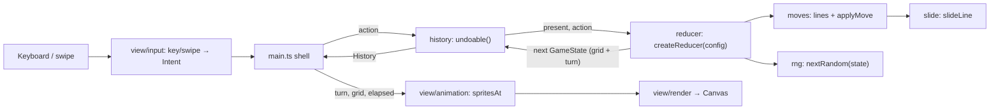

# 010 — 2048 as a Pure Reducer

> 2048 where the entire rule set is one pure function, `(state, action) => state`, with seeded spawns, undo/redo for free, and a canvas shell that only draws.

**Stack:** TypeScript · **Level:** Starter · **Track:** Foundations

## What it is

A complete, playable 2048. Slide tiles with the arrow keys, WASD, or a swipe. Equal tiles merge, every move spawns a new 2 (or sometimes a 4), and you win at 2048 (then you can keep going). Undo and redo work at any time, including after a loss.

The game logic is a reducer with no side effects. The browser shell sends it actions and animates what it returns. Tiles slide with an ease-out curve, merges pop, and spawns grow in. All of it is computed by a pure function of the turn record and elapsed time.

```
 score 20                 moves 8  ⟲
 ┌─────┬─────┬─────┬─────┐
 │  2  │     │     │     │      action: { type: "move", direction: "left" }
 ├─────┼─────┼─────┼─────┤         │
 │     │     │     │     │         ▼
 ├─────┼─────┼─────┼─────┤      reduce(state, action) → next state
 │  2  │  2  │     │     │         │   grid, score, status, rng, nextId
 ├─────┼─────┼─────┼─────┤         ▼   turn: slides / merges / spawns
 │  4  │  8  │  2  │     │      view animates `turn`, then draws `grid`
 └─────┴─────┴─────┴─────┘
```

## Gaming technique: the 2048 move

A move is the same operation applied to each row or column:

1. **Cut the board into lines**, each ordered from the edge the tiles move toward. `lines(size, "right")` gives each row right-to-left, and `lines(size, "down")` gives each column bottom-to-top. One `slideLine` then handles all four directions without rotating the grid.
2. **Slide one line** (`slideLine`): drop the gaps, then walk from the leading edge and merge equal neighbors. A merged tile is skipped right away, so it can't merge again in the same move. That is why `[2, 2, 2, 2]` becomes `[4, 4]`, not `[8]`, and `[4, 4, 8]` becomes `[8, 8]`, not `[16]`. Getting this rule wrong is the classic 2048 clone bug.
3. **Moves that change nothing are illegal.** If no tile moves or merges, there is no spawn and no move count. Without this rule, a player could fill the board by mashing a blocked direction.
4. **Spawn** a tile on a uniformly random empty cell: a 2 with 90% probability and a 4 with 10% (`fourChance`).
5. **End checks.** The game is won when a tile reaches `target`. It is lost when the board is full and no two orthogonal neighbors match. Those are the only conditions where every direction is blocked, so the check doesn't need to simulate four moves.

Shipped puzzle games (Threes!, 2048, Triple Town) are built this way because the whole game is a deterministic transition plus one random event per turn. That makes them easy to replay, undo, test, and solve with AI.

## Software engineering concepts

- **Pure reducer (the Elm/Redux pattern).** `createReducer(config)` returns `(state, action) => state`. It has no mutation, no clock, and no `Math.random`. A test deep-freezes a state and runs every direction against it to prove the reducer never writes to its input.
- **Randomness as state.** The RNG is a pure step function, `nextRandom(rngState) → [value, nextState]`, and its state is a field of `GameState`. That is how a game with random spawns can still have a pure reducer: the seed goes in through the `newGame` action, and from then on the next spawn is fully determined by the state.
- **Reference equality as a contract.** A no-op action (a blocked move, a move after the game ends, `keepPlaying` when not won) returns the *same object*. The shell uses `next === prev` for change detection, and the undo wrapper uses it to avoid recording no-op moves.
- **Higher-order reducer for undo.** `undoable(reducer, { limit, resets })` wraps any reducer with `past / present / future`. Because states are immutable, history is just a list of references, with no command objects or inverse operations (compare project 006, which uses the Command pattern for undo). Each snapshot carries its RNG, so an undone and repeated move spawns the same tile. This blocks "undo to reroll" exploits.
- **Stable identity for animation.** Tiles have ids. A move records `slides` (every pre-move tile, old cell → new cell), `merges` (new id + both source ids), and `spawns`. `view/animation.ts` turns that record and the elapsed time into sprites, so the view never diffs boards or re-derives rules.
- **Config validated once.** `validateConfig` runs when the reducer is built (board size, power-of-two target, start tiles, spawn odds). Bad configs throw a `RangeError` there, and the hot path assumes valid input.
- **Text fixtures.** `fromRows(["2 . 2 4", ...])` and `toRows` keep tests readable: each direction's expected board is written out as rows.

**Trade-offs**
- Allocating a new grid for every move is negligible for 16 cells. For a large board or a search-based AI that explores millions of moves, a bitboard (one 64-bit integer, 4 bits per tile, with precomputed per-row lookup tables) is the usual choice, but it gives up stable tile ids.
- Keeping `turn` (the animation record) in `GameState` puts presentation data in the model. The alternative is having the view diff consecutive states by tile id, which is more work and loses which two tiles merged. Here `turn` is plain, deterministic data, so the reducer stays pure.
- Undo stores whole states, so memory grows with `limit × state size`. That is trivial at 64 × 16 cells. A long-running editor would store patches instead.
- A seeded RNG in the state means a player who reads the state can predict spawns. That is fine for a single-player puzzle. A competitive game would keep the seed on a server.

## Architecture



## Build, run, and test

```bash
npm install
npm run dev     # play at http://localhost:5173 (add ?seed=42 for a reproducible game)
npm test        # 52 unit tests (Vitest), including a 200-game invariant soak test
npm run build   # typecheck + production bundle
```

Controls: arrows / WASD / swipe to move · U undo · Y redo · R restart the same seed · N new game · C keep playing after winning.

## Project structure

```
src/
├── core/
│   ├── config.ts    # GameConfig + validation
│   ├── grid.ts      # immutable grid, tile ids, text fixtures
│   ├── slide.ts     # slideLine: the one-line merge rule
│   ├── moves.ts     # direction → lines, applyMove, canMove, hasAnyMove
│   ├── reducer.ts   # GameState, actions, spawnTile, createReducer
│   ├── history.ts   # undoable(): undo/redo as a higher-order reducer
│   └── rng.ts       # pure mulberry32 step function
├── view/
│   ├── animation.ts # turn record + elapsed → sprites (pure)
│   ├── input.ts     # key codes and swipes → intents (pure)
│   └── render.ts    # canvas drawing, procedural tile colors
└── main.ts          # browser shell: input, rAF loop, dispatch
tests/
├── slide.test.ts    # line rule, every direction, ids, fixtures, config, rng
├── reducer.test.ts  # actions, purity, determinism, win/loss, undo, soak test
└── view.test.ts     # animation timing, input mapping, tile colors
```

The soak test plays 200 seeded games to completion and checks invariants after every move: tile ids are unique, the board total equals the sum of all spawned tiles (merges conserve value), the score equals the sum of all merges, and a lost board really has no moves (checked by an independent oracle).

## Possible extensions

- Bitboard backend (one `bigint` with row lookup tables) behind the same reducer interface, plus a benchmark comparing it with the array version
- Expectimax AI that uses the reducer directly as its transition model
- Replays: store `seed + direction[]` and rebuild any game by folding the reducer over it
- Persist `History` to `localStorage` and resume after a reload, with schema versioning
- Variants as configs: 5×5, 3×3, target 4096, or a "Fibonacci" merge rule injected as a strategy
