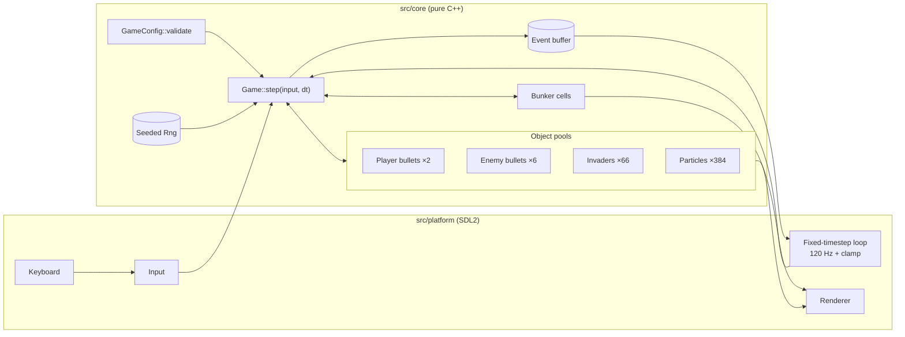

# 011 — Space Invaders with Object Pools

> An Invaders-style arcade shooter where every bullet, invader, and spark of debris lives in a fixed-size object pool, so the game never touches the heap allocator after it starts. A test enforces that.

**Stack:** C++20 + SDL2 · **Level:** Intermediate · **Track:** Foundations

## What it is

A complete invaders game. A 5×11 formation marches across the screen, drops a row each time it reaches a wall, and speeds up as you thin it out. The bottom invader in each column shoots back. Four destructible bunkers break apart cell by cell. When you clear a wave, the next one starts lower. You lose when your lives run out or when the fleet reaches your row.

An overlay (toggle with **F1**) shows each pool live: how full it is, its high-water mark (yellow tick), and how many spawn requests it refused (red `X` count).

```
 SCORE 340        WAVE 2        LIVES 3
 PB [███████████████            ] 1/2
 EB [██████████     |           ] 3/6
 IN [████████████████████|      ] 41/66
 FX [███    |                   ] 28/384

     ▄█▄  ▄█▄  ▄█▄  ▄█▄  ▄█▄  ▄█▄  ▄█▄
     ▀▄▀  ▀▄▀  ▀▄▀       ▀▄▀  ▀▄▀  ▀▄▀
     ███  ███       ███  ███  ███  ███
               ¦               ¦
      ▄██▄        ▄██▄        ▄▀█▄       ▄██▄
      █▀▀█        █  █        ▀  █       █▀▀█
                        │
                       ▄█▄
 ─────────────────────────────────────────────
```

Controls: **←/→** or **A/D** move, **Space**/**↑**/**W** fire, **F1** pool overlay, **R** restart after game over, **Esc** quit. Pass `--seed N` to replay a game exactly.

All sprites, including three original invader designs with two animation frames each, are drawn from string bitmaps in `src/platform/Sprites.hpp`. There are no image files.

## Gaming technique: object pooling

Shooters create and destroy objects constantly. In this game every shot, every enemy shot, and fourteen pieces of debris per explosion are born and die within a second or two. If each of those calls `new` and `delete`:

- **Frame time gets spiky.** General-purpose allocators are fast on average but have slow paths: taking a lock, splitting or merging free blocks, or asking the OS for more pages. A 2 ms stall in a 16 ms frame is a visible hitch.
- **The heap fragments.** Long sessions full of small, short-lived allocations scatter live objects across memory, which hurts cache locality and can eventually make large allocations fail on consoles that have no virtual memory to fall back on.
- **Iteration chases pointers.** A `std::list` or `vector<unique_ptr>` of bullets puts each bullet somewhere different in memory.

An **object pool** reserves storage for the maximum number of objects once and recycles slots forever after. `ObjectPool<T, N>` in `src/core/ObjectPool.hpp` has:

| Part | What it does |
|------|--------------|
| `std::array<std::optional<T>, N>` | In-place construction and destruction, with no heap |
| Free-list stack | O(1) acquire and release. LIFO order reuses the most recently freed, still cache-warm slot |
| Dense index array + back-pointers | Iteration touches only live objects. Release is an O(1) swap-and-pop |
| Generation counters | A `PoolHandle` becomes stale when its object dies, so a recycled slot can't be reached through an old reference (the "ABA" problem) |
| `highWater()` / `exhaustedCount()` | The numbers you log in playtests to size each pool |

**Pool exhaustion is a design decision, not an error.** `acquire` returns `std::nullopt` when full, and each caller decides what that means:

- **Player bullets (capacity 2):** the full pool *is* the arcade rule that limits how many shots you can have on screen. You can't fire until a shot lands.
- **Enemy bullets (capacity 6):** caps how much fire is in the air on later, faster waves.
- **Particles (capacity 384):** cosmetic, so extra debris is simply dropped.
- **Invaders (capacity 66):** sized from config. `GameConfig::validate()` rejects a formation that can't fit, so wave setup can never fail halfway.

Shipped games use the same idea. Bullet-hell shooters preallocate thousands of bullets, Unity ships `UnityEngine.Pool.ObjectPool<T>`, Unreal pools particles inside Niagara, and the original arcade hardware simply had a fixed number of sprite slots.

Other arcade techniques in the simulation:

- **Shared formation origin.** An invader stores only its `(row, col)`. Its position is derived from one formation origin, so marching 55 invaders is a single vector addition.
- **Speed-up by attrition.** The march interval is interpolated from the number of live invaders, which reproduces the famous acceleration of the arcade original with no extra state.
- **The bottom invader in each column fires.** Scratch arrays on the stack pick a shooter without allocating.
- **Directional bunker erosion.** A shot from below chips the lowest cell it overlaps, and a shot from above chips the highest, so holes tunnel through realistically.

## Software engineering concepts

- **Zero-allocation invariant, enforced by a test.** `tests/test_no_allocations.cpp` replaces the global `operator new` with a counting version, plays two minutes of busy game time (constant fire, restarts after each game over), and asserts the count stays at **0**. It runs as a separate test binary so the replacement can't affect the other tests.
- **Functional core, imperative shell.** `src/core` has no SDL, clock, or I/O. `Game::step(input, dt)` is called by the SDL shell's fixed-timestep loop (120 Hz with a frame-time clamp). The `Renderer` only reads state.
- **Injected time and randomness.** `dt` is a parameter and the `Rng` is passed in. The game draws exactly one random number per tick for fire chance, however many invaders are alive, so tuning changes don't reshuffle the random stream. A test plays 30 s of scripted input twice and compares `stateHash()`.
- **Events instead of callbacks.** The core records `PlayerHit`, `InvaderKilled`, and other events in a vector that is reserved once. The shell reads them to trigger the red hit flash. `emit` drops an event rather than growing the vector.
- **Fail fast on configuration.** `GameConfig::validate()` throws `std::invalid_argument` naming the bad field, for example "formation is wider than the world" or "exceeds pool_capacity::kInvaders". After that the simulation can trust its numbers.
- **RAII and value semantics.** Pools are non-copyable because handles refer to one specific pool. Destroying a pool destroys its live objects, which a test checks with a counting type.
- **Model-based stress test.** 50,000 random acquire, release, and `removeIf` operations run against both the pool and a `std::map` reference, and the two must agree after every operation.

**Trade-offs**

- **Fixed capacity is a hard ceiling.** Sizing pools needs playtest data, which is why the overlay shows the high-water mark. Growable pools (chunked arenas) avoid the ceiling but give up the "never allocates" guarantee and stable worst-case memory.
- **`std::optional<T>` costs a flag per slot and needs T to be movable or constructible in place.** Raw aligned storage with placement new saves a few bytes but is easier to get wrong.
- **Swap-and-pop reorders live objects.** Draw order and iteration order change when something dies. That doesn't matter for bullets, but a sprite system that needs stable order would sort or use a sparse set with stable indices instead.
- **Compile-time capacities.** Pool sizes are template arguments, so changing them means recompiling. In exchange, the whole game state is one fixed-size object with no indirection.
- **Particles live in the core.** Debris is cosmetic, but simulating it there keeps it deterministic and gives the pool a high-churn workload. A larger engine would move it to a separate effects system.

### Benchmark

`pool_benchmark` spawns 48 bullets per frame, moves them all, and destroys those that leave the screen, keeping about 2,000 alive. It runs this for 20,000 frames against three containers. It's a Release build, run in this project's cloud sandbox, so the absolute numbers will vary by machine:

```
20000 frames, 48 spawns/frame
pool             74.62 ms    3730.9 ns/frame  peak  2045 live  x1.00 vs pool
vector<ptr>     102.10 ms    5105.2 ns/frame  peak  2045 live  x1.37 vs pool
list            380.63 ms   19031.3 ns/frame  peak  2045 live  x5.10 vs pool
```

The benchmark verifies that all three containers simulated the same bullets before it reports. glibc's allocator is very good at same-size churn, so `vector<unique_ptr>` stays fairly close. The list's pointer chasing is the real cost. The pool's bigger advantage is predictability: no allocator slow paths and no fragmentation, which an average time can't show.

## Architecture



## Build, run, and test

Requires CMake 3.20+ and a C++20 compiler. SDL2 is needed only for the game executable. Catch2 v3 is found locally or fetched automatically.

```bash
# dependencies (Debian/Ubuntu; use brew install sdl2 catch2 on macOS, or vcpkg)
sudo apt install cmake g++ libsdl2-dev catch2

cmake -S . -B build            # defaults to a Release build
cmake --build build -j

./build/invaders               # play
./build/invaders --seed 42     # reproducible game

ctest --test-dir build --output-on-failure   # 40 tests (Catch2)
./build/pool_benchmark 20000                 # pool vs vector<unique_ptr> vs list
```

If SDL2 isn't installed, CMake prints a warning and still builds the core library, tests, and benchmark.

## Project structure

```
011-space-invaders-with-object-pools/
├── CMakeLists.txt
├── src/
│   ├── core/                 # no SDL, no clock, no I/O
│   │   ├── ObjectPool.hpp    # fixed-capacity pool: free list, dense list, generations
│   │   ├── Game.hpp/.cpp     # formation, firing, collisions, waves, events
│   │   ├── Bunker.hpp/.cpp   # destructible cell grid
│   │   ├── Config.hpp/.cpp   # tunables, pool capacities, validation
│   │   ├── Geometry.hpp      # Vec2, Rect, AABB overlap
│   │   └── Rng.hpp           # xorshift64* PRNG
│   └── platform/
│       ├── main.cpp          # SDL window, input, fixed-timestep loop
│       ├── Renderer.hpp/.cpp # draws state + pool overlay
│       └── Sprites.hpp       # procedural bitmaps and 3x5 font
├── tests/
│   ├── test_object_pool.cpp  # pool semantics + model-based stress test
│   ├── test_game.cpp         # gameplay behaviour, determinism
│   ├── test_bunker.cpp
│   ├── test_config.cpp
│   ├── test_no_allocations.cpp  # counts operator new during play
│   └── TestSupport.hpp
└── bench/
    └── pool_benchmark.cpp
```

## Possible extensions

- **Mystery saucer.** Add a fifth pool of capacity 1 that crosses the top of the screen with a random score.
- **Procedural sound.** Synthesize the four-note march and the explosion noise into an SDL audio queue that the event buffer drives.
- **Struct-of-arrays pool.** Store bullet `x`, `y`, and `vy` in separate arrays for SIMD movement, then benchmark it against this array-of-structs layout.
- **Growable chunked pool.** Allocate fixed-size chunks on demand, never free them during play, and compare tail latency with this fixed pool.
- **Frame-time histogram.** Record per-step times in the shell to show the allocator's slow paths, which the average hides.
- **Input recording.** Save `(seed, inputs)` to a file and replay it, building on project 005.
