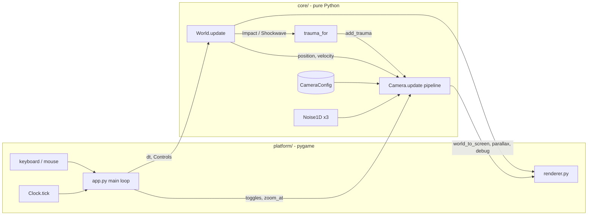

# 012 — 2D Camera Systems

> A scrolling space arena where the camera is the star: smooth follow, deadzone, velocity look-ahead, level bounds, and trauma-based screen shake, each switchable live so you can feel what it adds.

**Stack:** Python + pygame · **Level:** Starter · **Track:** Foundations

## What it is

Fly a small ship around a 3200×2000 arena of procedurally placed rocks over a parallax starfield. Bumping into walls and firing shockwaves add *trauma* to the camera, which shakes with coherent noise. Keys **1–5** switch each camera stage on or off, **Tab** shows the debug overlay (deadzone box, camera goal, look-ahead focus point), and the mouse wheel zooms toward the cursor.

```
 ┌───────────────────────────────────────────────────────────────┐
 │ 1 Smooth follow: ON      ·        ·          zoom 1.00  120fps│
 │ 2 Deadzone: ON                 ·                    ┌──────┐  │
 │ 3 Look-ahead: ON     ┌─────────────────┐   ·        │ rock │  │
 │ 4 Bounds: ON         │ deadzone   ○ ◄───── focus    └──────┘  │
 │ 5 Trauma shake: ON   │       +  ◄──────── goal  ·             │
 │ Trauma ▓▓▓▓░░░░      │     ➤ ship      │                      │
 │        ·             └─────────────────┘    ·      ·          │
 │  ┌────┐        ·                ·                   ·         │
 │  │rock│   ·          ·                    ·                   │
 │  └────┘                                                       │
 │ WASD fly · Space shockwave · T trauma · wheel zoom · R reset  │
 └───────────────────────────────────────────────────────────────┘
```

## Gaming technique: the camera pipeline

A camera that is hard-locked to the player is easy and feels terrible: every jitter of the character jerks the whole screen, and you can't see where you're going. Shipped 2D games (Super Mario World, Celeste, Hollow Knight, Dead Cells) stack several small behaviors instead. This project runs them as a fixed pipeline each frame:

```
 target pos, velocity
        │
        ▼
 1 Look-ahead    focus = target + ease(velocity · t_ahead, capped)
        │
        ▼
 2 Deadzone      goal moves only by how far focus pokes out of a window
        │
        ▼
 3 Bounds        clamp goal so the view would stay inside the level
        │
        ▼
 4 Smooth follow position += (goal − position) · (1 − e^(−dt/T))
        │
        ▼
 5 Bounds        clamp position (easing must never reveal the void)
        │
        ▼
 6 Trauma        trauma −= decay·dt   ──►  render-time shake only
```

- **Smooth follow** uses an *exponential* ease. `1 − e^(−dt/T)` is the exact solution of "approach the goal at a rate proportional to the gap", so the camera behaves identically at 30, 60, or 144 FPS. The common `lerp(pos, goal, 0.1)` per frame moves twice as fast at 120 FPS as at 60. A test proves 120 steps of 1/120 s equal 30 steps of 1/30 s.
- **Deadzone** (Mario's "camera window"): small movements like idling, aiming, or dodging don't move the screen. When the focus leaves the box, the goal moves by exactly the overshoot. The box is defined in screen units, so it keeps the same on-screen size at any zoom.
- **Look-ahead** leads the player by velocity × time, capped, so you see what you're flying into. The offset itself is eased, so reversing direction swings the view over a third of a second instead of snapping.
- **Bounds** keep the view inside the level. If the level is smaller than the view on an axis, the camera centers on it instead. The *goal* is clamped as well as the position. Otherwise the goal drifts past the edge while you push against a wall, and when you turn back the camera sits still until the goal crawls back into range (there's a test for exactly this).
- **Trauma shake** (Squirrel Eiserloh, *Math for Game Programmers: Juicing Your Cameras with Math*, GDC 2016): hits *add trauma* in [0, 1], which decays linearly. Shake intensity is `trauma²`, so small bumps are subtle and big hits are violent, and several hits stack naturally. The offset and roll come from **seeded Perlin noise** sampled at `time × frequency`, not `random()` each frame. That's smooth rather than static, frame-rate independent, and reproducible from a seed. Each channel (x, y, roll) has its own noise and phase, so they never all cross zero on the same frame.
- **Shake is render-only.** It is applied in `world_to_screen`, never to `position`, so culling, gameplay queries, and the follow logic aren't affected by the jitter.

Also included: **zoom toward the cursor** (the world point under the mouse stays put), and **parallax** background layers via `parallax_scroll(depth)`.

## Software engineering concepts

- **Pure core, thin shell.** `core/` (vectors, noise, camera, world) never imports pygame. `platform/` turns the wall clock into `dt` and the keyboard into `Controls`, then draws whatever the core says. All 65 core tests run without a display.
- **Pipeline of independently switchable stages.** Each stage is a few lines in `Camera.update`, guarded by a flag in `CameraConfig`. That's what makes the A/B toggles in the demo possible, and lets each test enable only the stage it checks (`helpers.BARE` turns everything off).
- **Immutable, validated configuration.** `CameraConfig` and `WorldConfig` are frozen dataclasses that reject bad values at construction. `toggled()` / `with_changes()` return validated copies, so a live tweak can never put the camera in an invalid state.
- **Events instead of coupling.** The world doesn't know a camera exists. `World.update` returns `Impact` and `Shockwave` events, and `trauma_for(event)` is the single place designers tune how hard each one shakes. The same events could drive sound or rumble.
- **Injected time and randomness.** `dt` is a parameter everywhere. One seeded `random.Random` builds the rocks, the stars, and the shake noise tables, so a seed reproduces the whole session, and headless runs use a scripted autopilot at a fixed 1/60 s.
- **Debug state as data.** `Camera.debug` exposes the focus point, goal, and deadzone from the last update. The overlay draws it, and the tests assert on it.
- **Robust collision.** The ship moves in sub-steps no longer than half its size and resolves one axis at a time. A 20,000-frame soak with random frame times checks that it never overlaps a rock or leaves the world. Separately, a 5,000-frame random walk checks that the camera view never leaves the bounds.

**Trade-offs**
- A fixed stage order is simple and predictable but less flexible than a list of pluggable "camera modifiers" (as in Cinemachine). For five behaviors, flags are easier to read and test. A modifier list pays off once you add zones, cutscene rails, or multiple targets.
- Exponential smoothing has no overshoot and is stable for any `dt`, but it never truly arrives, and it lags a constantly moving target by `velocity × T`. A critically damped spring (SmoothDamp) gives a softer start at the cost of one more state variable. Look-ahead compensates for the lag here.
- Shake isn't clamped to the level bounds, so on a big hit at the edge you can glimpse a few pixels past the border. Clamping it would mute shake exactly where the player is pinned against a wall. Games usually accept the glimpse, or draw a margin of level art beyond the playable area.
- The background stars wrap in screen space and ignore zoom and roll. That's cheap and reads fine for far layers, but a near layer would need the full transform.
- Variable `dt` with a 1/20 s clamp keeps the shell simple, which is fine because every camera and world update is written to be `dt`-correct. See project 001 for a fixed-timestep loop.

## Architecture



## Build, run, and test

```bash
python -m venv .venv && source .venv/bin/activate
pip install -e ".[dev]"

camera2d                      # or: python -m camera2d
camera2d --seed 7 --width 1600 --height 900

pytest                        # 68 tests; the core needs no display
```

Controls: **WASD / arrows** fly, **Space** shockwave, **T** add trauma, **1–5** toggle follow / deadzone / look-ahead / bounds / shake, **Tab** debug overlay, **mouse wheel** zoom toward the cursor, **R** reset, **Esc** quit. `camera2d --frames 600` runs a deterministic autopilot for 600 frames and exits. The smoke tests use it with SDL's dummy video driver, so they pass headless.

## Project structure

```
src/camera2d/
├── core/
│   ├── vec.py          # immutable Vec2 and Rect (no pygame types)
│   ├── noise.py        # seeded 1D Perlin noise for coherent shake
│   ├── config.py       # CameraConfig: validated tuning + feature switches
│   ├── camera.py       # the pipeline: look-ahead, deadzone, bounds, follow, trauma; transforms, zoom, parallax
│   └── world.py        # arena generation, ship physics, sub-stepped collision, events, trauma_for
├── platform/
│   ├── renderer.py     # procedural drawing, culling, debug overlay, HUD
│   └── app.py          # main loop, input -> Controls, CLI, headless autopilot
└── __main__.py
tests/                  # vec, noise, config, camera stages, world physics, headless smoke
```

## Possible extensions

- Critically damped spring follow (SmoothDamp) as an alternative stage, with a side-by-side comparison
- Camera zones / rooms (Hollow Knight style) that swap bounds and lock axes as the player crosses triggers
- Multi-target framing for local co-op: follow the bounding box of all players and zoom out to fit
- Platformer-style vertical behavior: only re-anchor the camera's y when the player lands
- Directional shake and per-event "kick" impulses, plus rumble driven by the same trauma value
- Record `Controls` per frame for replays (see project 005) to compare camera tunings on identical input
