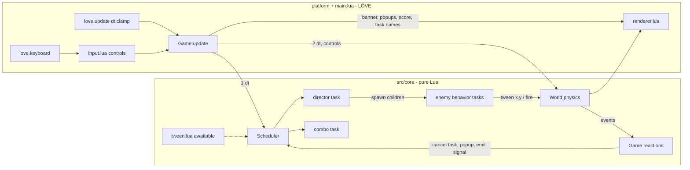

# 013 — Coroutines & Timers

> A vertical wave shooter where every entrance, attack pattern, boss phase, banner and respawn is a straight-line Lua coroutine script, driven by a small scheduler with frame-rate-exact timers, tweens, and structured cancellation.

**Stack:** Lua + LÖVE · **Level:** Starter · **Track:** Foundations

## What it is

Coroutine Waves is a short shmup: three waves of drones and gunners, then a two-phase boss. Drones swoop along curved paths into formation, sway, telegraph with a flash, and dive at you. Gunners slide in shielded, then repeat a beat of glow, aimed three-way spread, and strafe. The boss sways while firing rotating rings, and becomes "ENRAGED" at half health, switching to a spiral plus aimed bursts. Quick kills chain into a score multiplier.

None of those behaviors is a state machine. Each one is a function that reads like its design note, and **F3** shows the live task list while you play.

```
 ┌──────────────────────────────────────────┐
 │ 0005450                         WAVE 4/4 │
 │ tasks: 7          •    •                 │
 │  boss      x1  •     ▄███▄     •         │
 │  race#1    x1      ██ ◯ ██        •      │
 │  all#2     x1  •    ▀███▀   •            │
 │                •   ▬▬▬▬▬▬▬     •         │
 │        •     •   ENRAGED  •       •      │
 │                     |                    │
 │                     |                    │
 │                     ▲                    │
 │ ▲▲▲                          10 chain x3 │
 └──────────────────────────────────────────┘
```

## Gaming technique: coroutine-driven scripting

Most of a game's *continuous* logic is a per-frame `update(dt)`: move bullets, test collisions. But much of what designers ask for is a *sequence over time*: "fly in along this curve, wait two seconds, flash, fire three shots, strafe, repeat." Written as per-frame code, that becomes a state enum, a timer per state, and transitions sprinkled through `update`. A coroutine can pause in the middle of a function and resume later, so the sequence can be written as a sequence:

```lua
function Behaviors.gunner(game, enemy, opts)
  sched:tween(enemy, 0.8, { x = opts.slot[1], y = opts.slot[2] }, "back_out")
  while true do
    sched:wait(rng:range(0.7, 1.4))
    sched:tween(enemy, 0.25, { flash = 1 }, "quad_in")      -- telegraph
    local aim = world:aim(enemy.x, enemy.y)
    for k = -1, 1 do world:fire(enemy.x, enemy.y, aim + k * 0.22) end
    sched:tween(enemy, 0.9, { x = rng:range(40, 440) }, "quad_in_out")
  end
end
```

This is how Unity's `IEnumerator` coroutines (`yield return new WaitForSeconds`), Godot's `await`, Defold and Roblox scripts, and many in-house cutscene and bullet-pattern systems (Touhou-style danmaku scripts) work.

What this project's scheduler adds:

- **Awaitables.** A task yields an object with `advance(dt) -> done, leftover, ...results`. Delays, single frames, predicates (`wait_until`), named signals, joins, and tweens are all awaitables. Custom ones plug in through `sched:await(obj)`.
- **Frame-rate-exact timing.** When a wait finishes partway through a frame, the *leftover* time is carried into the next awaitable in the same frame, and into tasks spawned in that moment. `every(0.1, fn)` fires exactly ⌊t / 0.1⌋ times at 30 FPS, 144 FPS, or with jittery frames. A drone's position after 4 s is identical (to 1e-6) at 30 and 120 FPS, and the tests check both. The usual `timer = 0` reset after firing drifts later by up to a frame on every tick.
- **Tween sequences.** `sched:tween(obj, duration, {field = goal}, easing)` animates numeric fields and blocks until it finishes. Start values are captured when the tween *starts*, so consecutive tweens chain from wherever the previous step left the object. Eight easing curves are included (quad, cubic, sine, back with overshoot, elastic).
- **Composition.** `all{...}` runs children in parallel and waits for all of them. The drone dive tweens `x` with `sine_in_out` and `y` with `quad_in` at the same time, which makes it curve. `race{...}` returns the first child to finish and cancels the rest. That gives "sway *until* the dive timer fires" and "run phase 1 *until* health < 50%".
- **Structured cancellation.** Tasks spawned inside a task are its children, and cancelling a parent cancels the whole subtree. When an enemy dies, cancelling its task also stops its spiral timer and any half-finished tween. At game over, one `director:cancel()` clears every enemy and every pending spawn. `sched:defer(fn)` is the coroutine's `finally`: it runs on normal return *or* cancellation, so the respawn script always restores `invulnerable`/`visible`/`locked`, and every enemy is always removed from the world.

## Software engineering concepts

- **Continuous vs. discrete logic, separated.** `world.lua` is a plain per-frame simulation (movement, fire-rate accumulator, bullets, particles, collisions) and knows nothing about scripts. Scripts in `behaviors.lua` and `waves.lua` *drive* world entities. `game.lua` is the composition root: it runs scripts, then physics, then reactions to the events physics reported.
- **Protocol over inheritance.** The scheduler doesn't know what a tween is. Anything with `advance(dt)` is awaitable, and the scheduler only interprets the `done, leftover, ...results` it returns. Event-style awaitables set `event = true`, and the scheduler re-checks them at the end of each update until nothing else wakes ("settling"). That way a parent joining a child resumes in the frame the child finishes, whichever comes first in the update order.
- **Events and signals instead of coupling.** The world returns `enemy_killed` and `player_hit` events. The game reacts by cancelling the dead enemy's task, floating a score popup tween, and emitting a scheduler signal. The combo system is a separate script that waits on that signal and races "another kill" against a 1 s window. Neither the world nor the enemies know combos exist.
- **Ownership that survives helpers.** When a task returns while it still has running children (for example the `all` helper that streamed two lines of drones), it hands them to its own parent. Cancelling the director still reaches every enemy.
- **Errors that point at the script.** A runtime error inside a task is re-raised from `update` with the task's name and the *coroutine's* traceback. Without that, all you'd see is the scheduler's `resume` line. Yielding anything that isn't an awaitable, or calling `wait` outside a task, fails immediately with a clear message.
- **Injected time and randomness, portable core.** `dt` is a parameter everywhere, and one seeded MINSTD RNG drives every gameplay random choice. The renderer's starfield uses its own generator so it can't perturb the simulation. The core runs unchanged on LuaJIT (LÖVE), Lua 5.1, and Lua 5.4, with the same results, and avoids `goto`, `//`, `table.pack`, and yielding across `pcall`.
- **Validated configuration.** `Config.build` merges overrides into defaults, and rejects unknown keys and non-positive (or NaN) values.

**Trade-offs**
- Coroutine state is invisible. You can't serialize a suspended Lua coroutine, so save-anywhere or rollback netcode can't snapshot "the boss is 0.3 s into phase 2". Games that need that write behaviors as explicit state machines or behavior trees with plain-data state, or record inputs and re-simulate (see project 005).
- Scripts mutate shared state cooperatively. That's safe here because tasks interleave only at yields and run in deterministic spawn order, but two scripts tweening the same field fight over it. Real engines add tween "channels" or kill-existing-tween-on-target rules.
- Event awaitables complete on frame boundaries and carry no leftover time. A child finishing at t = 0.31 inside a 1/30 s frame resumes a joining parent with zero carry. Time-based waits stay exact; join/race/signal latency is "same frame", not "same instant".
- `wait(0)` is rejected rather than meaning "next frame". `frame()` is explicit, which keeps the carry loop provably terminating: every carried wait consumes positive time.
- Float accumulation means 30 frames of 1/30 s don't sum to exactly 1.0. Time-based awaitables use a `1e-9` tolerance, so a 1 s wait doesn't slip a whole frame.

## Architecture



## Build, run, and test

```bash
# install: LÖVE 11.x (https://love2d.org) and busted (Lua test runner)
luarocks install busted          # or: apt install love lua-busted

# run
love .                           # or: make run
love . 12345                     # fixed RNG seed
love . 7 --frames 600            # headless-friendly smoke run: 600 fixed frames, then quit

# test (core logic, headless, no LÖVE needed)
busted                           # 54 tests
make test-all                    # same suite on LuaJIT, Lua 5.1 and Lua 5.4

# package a .love file into build/
make love
```

Controls: **WASD / arrows** move, **Space / Z / J** fire (hold), **P** pause (game time, and with it every script, timer, and tween, stops), **F3** live task list, **R** play again after the run ends, **Esc** quit. All 54 tests pass on LuaJIT, Lua 5.1 and Lua 5.4. The game itself was also run under a virtual display (`xvfb-run love . 7 --frames 600`).

## Project structure

```
main.lua                  # LÖVE callbacks: dt clamp, pause, restart, --frames smoke mode
conf.lua                  # window and module config
Makefile                  # run / test / test-all / love
.busted                   # test runner config (adds src/ to the module path)
src/
├── core/
│   ├── scheduler.lua     # tasks, awaitables, carry-over timing, all/race/join, signals, defer, cancel
│   ├── tween.lua         # easing curves + Tween awaitable
│   ├── behaviors.lua     # drone, gunner and two-phase boss scripts
│   ├── waves.lua         # wave timelines and the director script
│   ├── world.lua         # per-frame physics: player, fire-rate accumulator, bullets, particles, collisions
│   ├── game.lua          # composition root: event reactions, banners, popups, respawn, combo, game over
│   ├── config.lua        # defaults and validation
│   └── rng.lua           # seeded MINSTD generator
└── platform/
    ├── input.lua         # keys -> {move_x, move_y, fire}; CLI args
    └── renderer.lua      # procedural drawing, letterboxed arena, HUD, task overlay
tests/
├── scheduler_spec.lua    # timing exactness, carry, frame/until/signal/join/all/race, cancellation, errors
├── tween_spec.lua        # easing shapes, interpolation, sequences at 30/60/144 FPS
├── game_spec.lua         # world physics, each behavior, kills, combos, respawn, game over, full-run victory, determinism
└── support_spec.lua      # config, rng, input mapping, arg parsing
```

## Possible extensions

- Bezier and Catmull-Rom path tweens so entrances follow smooth splines instead of linear waypoints
- A data-driven wave format (Lua tables or JSON) compiled into scripts, so designers can edit waves without touching code
- Tween channels: starting a new tween on a field automatically cancels the old one
- Time scaling per task group (slow-motion on the boss while the UI keeps normal speed)
- A "script debugger" overlay showing each task's current awaitable and remaining time
- Save/restore by recording inputs and re-simulating, since coroutines themselves can't be serialized
