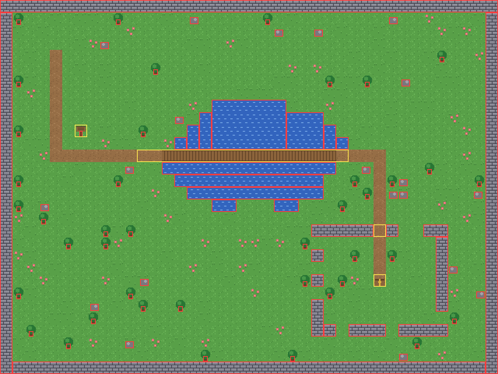
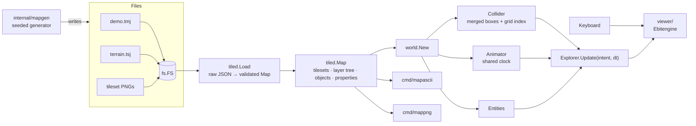

# 014 — Tiled Map Loader

> Load maps made in the Tiled editor, with tile layers, object layers, animated tiles and collision metadata, into a validated, engine-neutral Go model. Then walk around them in Ebitengine.

**Stack:** Go + Ebitengine · **Level:** Intermediate · **Track:** Foundations

## What it is

A complete pipeline from a [Tiled](https://www.mapeditor.org/) JSON export to a playable level:

- **`core/tiled`** parses `.tmj` maps and `.tsj` tilesets: CSV and base64 layer data (zlib or gzip), embedded and external tilesets, group layers, infinite chunked maps, every object shape, typed custom properties, per-tile collision shapes, tile animations, and the flip flags packed into tile IDs. Malformed data returns errors that say where the problem is.
- **`core/world`** turns that model into gameplay. It builds a collision index from tile metadata and collision object layers, runs a shared clock for tile animations, collects entities, and moves a top-down body with move-and-slide. A small `Explorer` game loop reads signs and opens chests, all driven by map properties.
- **Three front ends share that core.** `viewer/` is the Ebitengine game. `cmd/mapascii` prints a map to the terminal. `cmd/mappng` rasterizes one to PNG with only the standard library.
- **`internal/mapgen`** generates the demo map, its external tileset and the pixel-art tileset images from a seed, so the project contains no third-party art.



*`go run ./cmd/mappng -scale 2 -collision maps/demo.tmj docs/preview.png`. Red outlines are the collision boxes. Long red rectangles are runs of solid tiles merged into one box. The small red boxes are tree trunks and rocks taken from each tile's collision shape.*

```
$ go run ./cmd/mapascii maps/demo.tmj
########################################
#T..,.,,.T...,.o.....T.,.......o..*...,#
#,.,......*...........o..o.,..,....*,*.#
#.....,*o......,,.*,..........,........#
#.,.@.......................,..,..,T..*#
#...:.,.,...T...,......*.*....,....,...#
#T,.:...,.............,,..T,,T..o..,,..#
#.*.:..............,,,....,,...........#
#...:.....,....*.~~~~~~,..*....,.,,....#
#...:.........o,~~~~~~~~~~.....,....*..#
#T..:.?.,..T...~~~~~~~~~~~~..,.,.....*.#
#.,,:...*,,..*~~~~~~~~~~~~~~,..........#
#..*:::::::::==============::::.,....*.#
#.....,...o.,~~~~~~~~~~~~~~.,o:...T,.,,#
            … 16 more rows …

"Pondside Ruins": 40x30 tiles of 16x16 px
tileset terrain  gids 1-11 (terrain.tsj)
tileset markers  gids 12-13 (embedded)
layer   terrain/ground   tiles        visible=true
layer   terrain/decor    tiles        visible=true
layer   entities         objects      visible=true
layer   collision        objects      visible=false
collision boxes: 92 · entities: 5
```

The glyphs come from a `glyph` property on each tile in the tileset. The ASCII renderer contains no tile IDs, only the map's own metadata.

## Gaming technique: data-driven levels from a map editor

Hand-coding levels doesn't scale. Almost every 2D game, from indie platformers to RPGs, has designers build levels in an editor and has the game load them as data. Tiled is the most widely used free one, especially in indie and game-jam projects. A loader has to handle several things.

**Global tile IDs (GIDs).** Each tileset owns a range `[firstgid, firstgid+tilecount)` in one global numbering, and `0` means "no tile". To find a tile, take the tileset with the largest `firstgid ≤ id`. The top bits of a GID are not part of the ID. They are **flip flags** (horizontal, vertical, diagonal), and their combinations give the eight orientations of a square. Rotating a tile 90° clockwise is stored as diagonal+horizontal. `GID.Transform()` turns the flags into a 2×2 matrix. A test checks that the three bits produce eight distinct rotations and reflections, and that matrix is used both to draw tiles and to flip their collision shapes.

**Layer encodings.** Tile data is either a JSON array or base64-encoded little-endian `uint32`s, optionally compressed with zlib or gzip. Infinite maps store layers as chunks. This loader stitches the chunks into one dense grid with a possibly negative origin.

**Metadata becomes behavior.** Designers attach meaning in the editor instead of in code:

| Where in Tiled | Becomes in the game |
|---|---|
| Tile property `solid: true` (walls, water) | Full-tile collision, merged into large boxes |
| Shapes drawn in the tile collision editor (tree trunk, rock) | Exact collision boxes, flipped with the tile |
| Object layer with class `collision` | Extra invisible collision (the signpost's post) |
| Tile `animation` frames (water) | Frame chosen from a shared clock |
| Objects of class `spawn` / `trigger` / `chest` + properties | Player start, on-touch messages, loot and gold |
| Layer property `collides: false` | Decorative layer that doesn't collide |

**Greedy rectangle merging.** A 40-tile wall as 40 boxes wastes queries and leaves internal seams that can snag a sliding body. `MergeCells` grows each run of solid cells to the right and then downward. The demo map's walls and water come out as far fewer boxes than solid tiles. A property test checks on random grids that every solid cell is covered exactly once.

**Uniform-grid broadphase.** Each box is filed in the tile cells it touches. A query only looks at the cells under the query rectangle, so its cost depends on the size of the moving body, not on the size of the map.

**Move-and-slide with sub-stepping.** Movement resolves x and then y, so pushing diagonally into a wall keeps the motion along it. Motion is split into sub-steps no longer than half the thinnest collider. A test moves a body 10,000 px in one call against a 1-pixel wall and checks that it stops at the wall.

**Shared animation clock.** Tiled animates per tile type, not per cell, so every water tile shows the same frame. One clock and `elapsed % total` reproduce that at zero per-cell cost, and the result is a pure function of time.

## Software engineering concepts

- **Decode into raw types, convert into a validated model.** `raw.go` mirrors the JSON field by field (legacy `type` versus `class` names, optional values that default to 1 or true). The loader converts those into public types that guarantee every GID resolves, every tile fits inside its image and tileset ranges don't overlap. Game code never sees half-valid data.
- **Filesystem abstraction (`io/fs`).** All reads go through an `fs.FS`. Tests use in-memory `fstest.MapFS` fixtures, the tools use `os.DirFS`, and a shipping game can use `embed.FS`. It also gives a security property for free: `fs.FS` rejects paths that climb above its root, so a crafted `"source": "../../../etc/x"` cannot escape, and a test covers that.
- **Errors with context and identity.** Failures wrap the sentinels `ErrInvalid` / `ErrUnsupported` (and `fs.ErrNotExist`) with the path to the problem, e.g. `load level.tmj: layer "world": layer "ground": tiled: invalid map data: tile (1,1) has gid 7, which no tileset owns`. Callers branch with `errors.Is`, and humans can find the broken tile. `mapascii` maps `ErrUnsupported` to its own exit code.
- **Defensive limits.** `Options.MaxLayerTiles` caps allocations, and decompression reads at most one byte past the expected size. A hostile "zip bomb" layer is rejected without being fully inflated, and a test feeds one in.
- **Typed accessors with fallbacks.** `props.Int("gold", 0)` reads cleanly in game code, and `Lookup` is there when "missing" and "wrong type" need to be told apart.
- **Sum types via interfaces.** `Layer` is implemented by `*TileLayer`, `*ObjectGroup`, `*ImageLayer` and `*GroupLayer`, with the shared fields in an embedded `LayerInfo`. Renderers use a type switch. `Map.Flatten()` folds group visibility, opacity, offsets and parallax into the leaves so no front end reimplements that.
- **Functional core, multiple shells.** `core/` imports only the standard library. Time is passed in (`Explorer.Update(intent, dt)`, `Animator.Advance(dt)`) and generation randomness comes from a seed. The same core drives a GPU window, a terminal and a PNG rasterizer, which is the strongest evidence that the separation is real.
- **Configuration over hard-coding.** `world.Config` and `ExplorerConfig` name the conventions (`solid`, `collision`, `spawn`, `chest`, …), so another game can use different names without changing the core.
- **Generated assets are tested for staleness.** `TestCommittedMapIsUpToDate` regenerates the demo and compares loaded models and decoded pixels, not raw bytes, because zlib and PNG encoders may produce different but equivalent bytes across Go releases. The generator has its own SplitMix64 RNG, so a seed yields the same map on every Go version.
- **Integration test on real content.** `TestDemoChestIsReachable` runs a breadth-first search over the shipped map using the real collider, then replays the route through the real mover. A level edit that walls off the chest fails the test suite before a player ever sees it.

**Trade-offs**

- **AABBs for collision objects.** Polygons, ellipses and rotated rectangles collide as their bounding boxes. That is exact for the rectangles that make up most tile games and conservative for the rest. Exact shapes would need SAT or GJK. The trunk and rock shapes in the demo are rectangles and ellipses drawn to fit, so the approximation doesn't show.
- **Dense stitched grid for infinite maps.** It is simple and cache-friendly, but a very sparse infinite map allocates its whole bounding box. `MaxLayerTiles` bounds the cost. Streaming games would keep chunks separate and load them on demand.
- **Greedy merging is not optimal.** The minimum rectangle cover is harder to compute. Greedy runs in linear time and comes close in practice.
- **Collision ignores layer render offsets and parallax.** Those are visual effects. Gameplay space is the tile grid.
- **No XML (`.tmx`/`.tsx`), templates, zstd, image-collection tilesets or non-orthogonal maps.** These return `ErrUnsupported` with a hint ("export as JSON", "detach templates") rather than being half-supported.
- **The Ebitengine viewer lives in its own Go module** (see below). The core module has zero dependencies and always builds. The cost is a `replace` directive and a separate `go mod tidy`.

## Architecture



## Build, run, and test

```bash
# core module: standard library only
go test ./...                                  # 63 tests and subtests: loader, world, generator, demo map
go test -bench . -run '^$' ./core/world/       # load / build-world / move-and-slide benchmarks
go run ./cmd/mapascii maps/demo.tmj            # print the map in the terminal
go run ./cmd/mappng -scale 2 -collision maps/demo.tmj out.png
go run ./cmd/genmap -out maps -seed 14         # regenerate the demo map and tileset images

# Ebitengine viewer: separate module, needs a desktop with OpenGL
cd viewer
go mod tidy                                    # fetches Ebitengine v2.8.x
go run . -map ../maps/demo.tmj                 # WASD/arrows move, C shows collision, Esc quits
```

On Linux, Ebitengine needs the usual X11/OpenGL headers first (`sudo apt install libgl1-mesa-dev xorg-dev`). macOS and Windows need nothing extra.

> **Note:** Ebitengine could not be downloaded in the environment where this project was built (the Go module proxy was not reachable), so the viewer was not run there. It was type-checked against stand-ins that mirror the Ebitengine v2.8 API. Everything else (the core, all tests, the benchmarks, and both headless renderers) was built and run. The preview image above comes from `cmd/mappng`, which implements the same drawing rules as the viewer using the same core calls.

Sample benchmark (2-vCPU cloud VM): loading the demo map takes about 0.3 ms, building the world about 0.06 ms, and a 500 px move-and-slide sweep across walls about 5 µs.

## Project structure

```
core/
├── geom/            Vec, Rect, 2x2 transforms
├── tiled/           the loader
│   ├── load.go          Load / LoadWithOptions, validation, chunk stitching
│   ├── raw.go           private mirrors of the JSON format
│   ├── data.go          CSV / base64 / zlib / gzip layer data, bounded inflate
│   ├── gid.go           GIDs, flip flags, orientation matrices
│   ├── map.go           Map, ResolveGID, Flatten, lookups
│   ├── layer.go         TileLayer, ObjectGroup, ImageLayer, GroupLayer
│   ├── tileset.go       Tileset, Tile, Frame, SourceRect
│   ├── object.go        Object shapes and rotated bounds
│   ├── properties.go    typed custom properties
│   └── color.go         #AARRGGBB parsing, image/color support
└── world/           gameplay built from a map
    ├── collider.go      collision sources, grid index, move-and-slide
    ├── merge.go         greedy rectangle merging
    ├── animator.go      shared tile-animation clock
    ├── world.go         World, entities, Actor, camera Follow
    └── explorer.go      the demo's game loop (signs, chests, messages)
internal/mapgen/     seeded generator for map, tileset and pixel art
cmd/
├── genmap/          writes maps/
├── mapascii/        terminal renderer
└── mappng/          PNG rasterizer (standard library only)
viewer/              Ebitengine front end (own go.mod)
maps/                generated demo: demo.tmj, terrain.tsj, terrain.png, markers.png
docs/preview.png     rendered by cmd/mappng
```

Tests sit next to the code they cover (`*_test.go`), as is idiomatic in Go.

## Possible extensions

- Exact polygon collision with the separating axis theorem, plus one-way platforms from a tile property.
- Object templates (`.tx`) and image-collection tilesets.
- XML `.tmx` support behind the same model, which would test that the raw-to-model split really isolates the format.
- Chunk streaming for large infinite maps, with chunks loaded and evicted around the camera.
- Hot reload: watch the map file and rebuild the `World` while the game runs.
- Wang/terrain-set metadata to auto-tile procedurally generated maps.
- Isometric and hexagonal orientations: a different cell-to-pixel transform with the same GID and property machinery.
