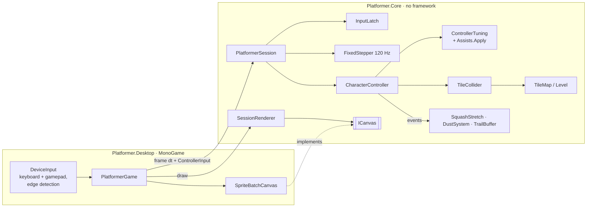

# 015 — Platformer Character Controller

> A kinematic platformer controller with the forgiveness tricks that make jumping feel tight (coyote time, jump buffering, variable jump height, apex hang and corner correction), each one switchable live so you can feel what it does.

**Stack:** C# + MonoGame · **Level:** Intermediate · **Track:** Foundations

## What it is

A MonoGame DesktopGL playground: one 40×22-tile level (640×352, scaled 2×) with a small orange character. Each part of the level tests one feature. There are two pits to run off, a low corridor with a one-tile notch in its ceiling, a staircase of floating platforms that each need a full held jump, and a two-tile step that a tapped jump can't clear. Everything is drawn from rectangles in code; there are no asset files.

Keys **1–5** switch each assist on and off. The HUD counts how often each one fired, so you can see that a jump you thought you made in time was actually a coyote jump. **F3** shows the debug overlay: the jump arc as a dotted trail, the movement phase, live velocity, derived gravity, and bars for the coyote and buffer timers as they count down.

```
 HUD: 1 COYOTE TIME ON   JUMPS 12   PHASE APEX   COYOTE [====    ]
      2 JUMP BUFFER ON   COYOTE 3   VX 165 VY -20 BUFFER [        ]
                                                                    ████  top ledge
                                                       ███
                                           ████                ·  ·   ← F3 trail
                                 ████                       ·        ·
                  ██ ███        (step-up)                  ·          ·
   P            corridor+notch            ████            ·            ·
 █████    ████████████████████████████████████    ███████████
       pit                                    pit
```

| Area | Feature it shows |
|---|---|
| Pit edges | **Coyote time**: jump a few frames after running off the edge |
| Ceiling notch over the corridor | **Corner correction**: clip the notch's edge and slide through |
| Floating staircase, 3 tiles per hop | **Apex hang** and full-height **held** jumps |
| Two-tile step | **Variable height**: a tap can't clear it, a held jump can |
| Any landing | **Jump buffer**: press just before touchdown and the jump still happens |

## Gaming technique

A platformer character is almost never a physics body. It is a **kinematic controller**: velocity is computed by hand from input and tuning, then the box is moved through the level and stopped by walls. That control is what makes the tricks below possible. Players judge a jump by what they *meant* to do, not by the exact frame they pressed, and these tricks close that gap. Celeste, Hollow Knight, Super Meat Boy and most modern Mario games use some or all of them.

**Jump arc from designer units.** Designers pick a jump **height** *h* and a **time to apex** *t*. The code derives gravity and launch speed from them: `g = 2h / t²`, `v₀ = 2h / t`. Changing gravity alone would change both the height and the timing; this way each number controls one thing. Falling uses a **fall-gravity multiplier** (1.8×), which gives the quick, weighty descent of a "Mario" jump instead of a symmetric parabola that feels floaty. A terminal velocity caps the fall.

**Coyote time** (0.1 s). Named after the cartoon coyote who runs off a cliff and only falls once he notices. When the character walks off a ledge without jumping, a timer starts; a jump pressed before it runs out still counts as grounded. Without it, a press one frame late does nothing and the player falls, and it feels like the game ate the input.

**Jump buffering** (0.12 s). The mirror image: a press made shortly *before* landing is remembered and fires on touchdown. This makes chained hops reliable.

**Variable jump height.** Releasing the button while rising multiplies upward speed by 0.45, once. A tap gives a short hop (under a third of full height) and holding gives the full arc, so one button covers a range of heights.

**Apex hang.** Near the top of a *held* jump (|vy| < 45 px/s), gravity drops to 0.45× and max run speed rises by 10%. The character floats for a moment, which makes it easier to line up a landing and gives a little extra reach.

**Corner correction** (up to 4 px). If a rising head clips a ceiling corner by a few pixels, the body is nudged sideways around it instead of stopping dead. Without this, the notch in the demo level is nearly impossible to hit.

**Acceleration model.** Horizontal speed approaches its target at different rates by context: ground acceleration, a stronger ground deceleration, an even stronger **turnaround** rate when the input opposes the current velocity (snappy reversals), and softer air rates (committed but steerable jumps). An analog stick maps to a proportional target speed.

**Axis-separated tile collision.** Movement resolves X first and then Y. Each move sweeps every tile column (or row) the leading edge crosses, so even a 5000 px fall stops on a one-tile floor. Boxes cover half-open ranges, so a body standing exactly on a seam doesn't snag.

**Fixed timestep.** The controller runs at 120 Hz behind an accumulator (see project 001). The coyote window is the same 12 steps at 30 fps and at 240 fps, and the jump arc doesn't change with frame rate. A test checks this.

**Squash and stretch, dust.** Cosmetic only: the sprite stretches on take-off and squashes on landing in proportion to impact speed, and dust puffs come from a seeded particle pool. None of it touches the collision box.

## Software engineering concepts

- **Separating simulation from presentation:** `Platformer.Core` has no MonoGame reference. It contains the controller, collision, level parsing, fixed stepping, effects, and a renderer that draws to an `ICanvas` interface with one method (`FillRect`). The desktop project only supplies that primitive, device polling and a window. All behavior is tested headlessly.
- **Data-driven tuning as an immutable record:** `ControllerTuning` is a `record` with `init` properties, derived values (`Gravity`, `JumpVelocity`) and `Validated()`, which names the first bad field. Live tweaks use `with` expressions instead of mutation, so a tuning object can be shared and compared safely.
- **Features as neutral values, not branches:** each assist has a value that turns it off (coyote 0 s, cut multiplier 1, apex gravity 1). `Assists.Apply` derives the live tuning from the base tuning and a `[Flags]` set, so toggles are reversible and the controller has no `if (coyoteEnabled)` checks. Making "off" truly neutral took care: apex gravity first *replaced* fall gravity, so "hang off" still changed the arc. It is now *multiplied* by fall gravity, and a test checks that tap and hold give identical arcs when both assists are off.
- **Events instead of callbacks:** the controller reports facts (`Jumped` with `JumpAssist` flags, `Landed` with impact speed, `JumpCut`, `HeadBump`, `CornerCorrected`) in a per-step list. Squash, dust and HUD counters read those facts; the physics code knows nothing about effects.
- **Input latch between frame and step:** `InputLatch` stores a press until exactly one simulation step consumes it. Without it, a press in a frame that runs zero steps would be lost, and a press in a frame that runs three steps would jump three times. Both cases have tests.
- **Injected time and randomness:** `Step(input, dt)` never reads a clock, and dust uses an injected `IRandom` (PCG32, checked against the reference vector). A seeded run with scripted input is fully reproducible, including particles.
- **Invariant stress test:** 60,000 steps of random input through the demo level, asserting after every step that the body never overlaps a solid tile.
- **Level-design tests:** tests check that the level matches its description: a held jump clears the two-tile step and a tap doesn't, the notch is only passable with corner correction, and every staircase hop lands on the next platform.
- **Trade-offs:**
  - *Kinematic vs. rigid body:* kinematic control gives exact, designer-tunable feel but no free physics interactions (pushing crates, slopes, moving platforms all need explicit code). Box2D-style bodies give those for free but fight every trick above.
  - *Axis-separated vs. full swept AABB:* resolving one axis at a time is simple and robust on tile grids, but the order matters at exact corners (X first here) and it doesn't generalize to slopes or arbitrary polygons.
  - *Semi-implicit Euler at 120 Hz:* simple and stable. The peak lands within a couple of pixels of the analytic `h`; an exact closed-form arc would need more code for very little gain.
  - *Renderer in the core:* keeps drawing testable and the host tiny, at the cost of a rectangle-only look. A sprite-based game would move drawing into the host.
  - *Offline test harness:* the test project compiles against real xUnit normally, or against a small in-repo copy of the same API (`OfflineHarness/`) for machines without NuGet access. That copy has to be kept in step with the assertions the tests use.

## Architecture



One controller step:

```
 timers ─► jump? (press live && (grounded || coyote)) ─► horizontal accel
        ─► jump cut (released while rising) ─► gravity × fall × apex
        ─► MoveX ─► MoveY (ceiling hit? try corner nudge) ─► grounded / landed / coyote start
```

## Build, run, and test

```bash
# install: .NET 8 SDK (https://dot.net). MonoGame comes from NuGet on first build.

# run (opens a 1280×704 window)
dotnet run --project src/Platformer.Desktop
dotnet run --project src/Platformer.Desktop -- 12345     # fixed seed for the dust

# test (core logic only, headless, 88 tests)
dotnet test tests/Platformer.Core.Tests

# test without NuGet access: same test files, in-repo xUnit stand-in
OfflineHarness=true dotnet run --project tests/Platformer.Core.Tests
OfflineHarness=true dotnet run --project tests/Platformer.Core.Tests -- Coyote   # filter by name
```

Controls: **←/→** or **A/D** move (or the left stick / d-pad), **Space/Z/↑/W** jump (or gamepad **A**), **1–5** toggle coyote time, jump buffer, variable height, apex hang and corner correction, **F3** debug overlay, **R** respawn, **Esc** quit.

**What was verified for this commit:** the core library and the full suite (88 tests) were built and run with the offline harness on .NET 8 in a Linux sandbox without NuGet access, and the core renderer's output was rasterized headlessly to check the layout. The MonoGame host couldn't be restored there, so it was type-checked against a stub of the MonoGame API it uses, but not compiled against the real package or run. `dotnet test` with real xUnit and `dotnet run` on the desktop host need a machine with NuGet access.

## Project structure

```
Platformer.sln
Directory.Build.props              # net8.0, nullable, C# 12 for every project
src/
├── Platformer.Core/               # no MonoGame reference
│   ├── Controller/
│   │   ├── CharacterController.cs # the kinematic controller: timers, jump, accel, gravity, move
│   │   ├── ControllerTuning.cs    # designer-facing numbers, derived g and v0, validation
│   │   ├── Assists.cs             # [Flags] feature set → neutralised tuning
│   │   └── ControllerEvent.cs     # Jumped/Landed/JumpCut/HeadBump/CornerCorrected + JumpAssist
│   ├── World/
│   │   ├── TileMap.cs             # solid grid, edge rules, overlap query
│   │   ├── TileCollider.cs        # swept per-axis moves, ceiling-corner nudge
│   │   ├── Level.cs               # ASCII level parser with spawn
│   │   └── DemoLevel.cs           # the playground layout
│   ├── Input/ControllerInput.cs   # per-step input + InputLatch (frame → step)
│   ├── Simulation/FixedStepper.cs # accumulator, step budget, interpolation alpha
│   ├── Effects/                   # SquashStretch, DustSystem (pooled, seeded), TrailBuffer (ring)
│   ├── Game/PlatformerSession.cs  # composition root: loop, events → effects, stats, respawn
│   ├── Rendering/                 # ICanvas, Rgba, 3×5 PixelFont, SessionRenderer
│   ├── Physics/                   # Vec2, Aabb
│   └── Randomness/Pcg32.cs        # seeded, platform-stable RNG
└── Platformer.Desktop/            # MonoGame DesktopGL host
    ├── Program.cs                 # seed parsing, run
    ├── PlatformerGame.cs          # Game subclass: commands, session update, scaled render target
    ├── DeviceInput.cs             # keyboard + gamepad → ControllerInput, hotkeys
    └── SpriteBatchCanvas.cs       # ICanvas via a 1×1 white texture
tests/Platformer.Core.Tests/
├── TileColliderTests.cs           # flush stops, no tunnelling, seams, edges, corner nudge
├── ControllerMovementTests.cs     # derived arc, accel/decel/turn, walls, fall gravity, terminal velocity
├── AssistTests.cs                 # coyote, buffer, variable height, apex hang, corner correction, toggles
├── SessionTests.cs                # latch, frame-rate independence, respawn, determinism, stress, level design
├── SupportTests.cs                # stepper, effects, level parsing, PCG32, font coverage
├── TestSupport.cs                 # test maps, step helpers, RecordingCanvas
└── OfflineHarness/                # xUnit stand-in + reflection runner (offline mode only)
```

## Possible extensions

- **Wall slide and wall jump**, with a short input lock after the wall jump so the player can't immediately steer back into the wall
- **One-way platforms** you can jump up through and drop down from (hold down + jump)
- **Slopes**, which need a ground-snapping step and a slope-aware MoveX
- **Moving platforms**, carrying the rider's velocity on take-off (momentum inheritance)
- **Ledge forgiveness on landing**: snap onto a platform edge that the feet miss by a pixel or two
- A **tuning file** (JSON) hot-reloaded while the game runs, reusing `Validated()` for error messages
- **Input replays** with the same seed (project 005) to record a run and A/B the same inputs with an assist on and off
