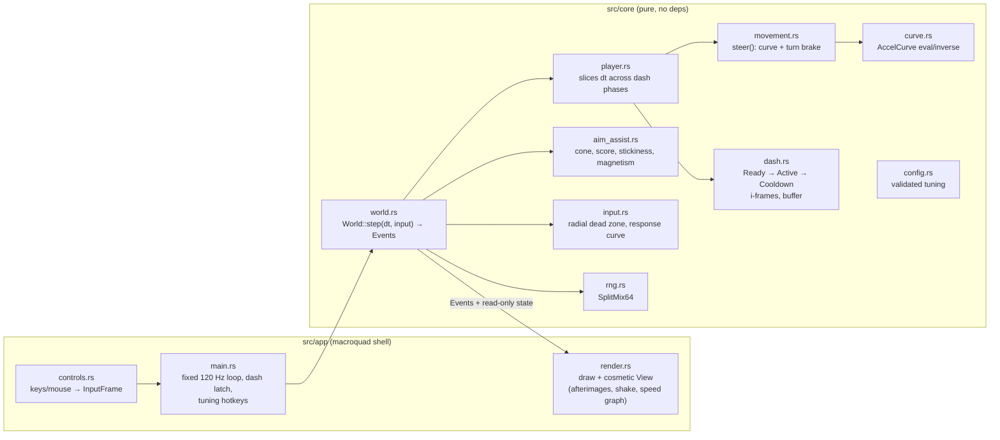

# 016 — Top-Down Movement & Dash

> Twin-stick movement that feels good: tunable acceleration curves, a frame-rate-independent dash with invulnerability frames and input buffering, and cone-based aim assist with stickiness, all in a dependency-free Rust core.

**Stack:** Rust + macroquad · **Level:** Starter · **Track:** Foundations

## What it is

A small top-down arena. You run with WASD, aim with the arrow keys (a digital "right stick") or the mouse, and shoot wandering training drones. Drones hurt on contact, so the dash is how you get out of trouble: during its i-frames you pass straight through them and a "DODGE" pops up. Press **1** to toggle aim assist and **2** to cycle the acceleration curve (ease-out → linear → ease-in) while you play; the speed graph in the HUD shows the ramp and the dash spike as they happen.

```
 HP #####   SCORE 4   DASH READY            WASD move  arrows/mouse aim ...
 [1] assist: on   [2] curve: ease-out   aim: keys (stick)   ╭speed────────╮
┌──────────────────────────────────────────────────────────────────────────┐
│        (◉)                                   ╲  assist cone              │
│                     ○ ○ ○  afterimages        ╲                          │
│                            ●─────────────·  ·  ·  ·  ·  ◎ ← locked target │
│                                              ╱                           │
│   (◉)                       DODGE           ╱               (◉)          │
└──────────────────────────────────────────────────────────────────────────┘
```

Everything is drawn with circles, lines and text: no textures, no external assets.

## Gaming technique

Top-down action games (Hades, Enter the Gungeon, Nuclear Throne, Hyper Light Drifter) live or die on how the character moves. Three systems do most of the work.

**Acceleration curves.** Instant full speed feels robotic and makes small adjustments impossible; slow linear acceleration feels like ice. Games pick a *time to top speed* (here 0.14 s) and then a *shape* for the ramp. An ease-out curve (`1 − (1 − t)²`) delivers 75 % of top speed in the first half of that time, which reads as "snappy but not instant". The mover splits velocity into the part along the stick and the part across it: along-stick speed follows the curve, while leftover sideways speed and reversals are braked at a boosted rate (`turn_brake_multiplier`), so sharp turns don't drift. Stick input goes through a **radial dead zone with rescaling** (so stick drift is ignored without a jump at the edge, and diagonals aren't snapped) and a **response exponent** for finer control at partial tilt.

**Dash with i-frames.** A dash is a fixed-distance burst (150 px in 0.15 s) at constant speed: no curve, no steering, so it's predictable. For a window measured from the dash start (0–0.20 s, deliberately a little longer than the dash itself to forgive late dodges) the character is invulnerable. A cooldown prevents spamming, and validation guarantees the i-frame window can never outlast it, so dashes can't be chained into permanent invulnerability. On exit the character keeps 60 % of running speed and flows straight back into the run. A press made up to 0.12 s before the dash is ready is **buffered** and fires the instant the cooldown ends, the same input buffering fighting games use so that slightly early inputs aren't eaten.

**Aim assist.** Aiming with a stick (or the 8-way arrow keys) is far less precise than a mouse, so console games quietly help. This implementation:

1. collects targets within range whose angular offset from the raw aim, *minus their angular radius*, fits inside a cone (big or close targets are easier to catch);
2. scores candidates by angle plus a smaller distance term, discounting the previously assisted target (**stickiness**) so the lock doesn't flicker between two similar targets;
3. rotates the aim toward the winner by a **strength** fraction (1 = snap, below 1 = nudge).

Strength is configured per input source: stick aim gets 0.85, mouse aim gets 0 by default, as many cross-play shooters do. The test `assist_turns_near_misses_into_hits_in_the_world` fires at a drone 7° off the arrow-key direction: without assist every bullet misses, with it the drone dies.

## Software engineering concepts

- **Functional core, imperative shell.** `src/core` knows nothing about macroquad, the clock or the OS RNG. `World::step(dt, &InputFrame) -> Vec<Event>` is the whole game; the shell in `src/app` samples devices, steps at a fixed 120 Hz, and turns events into feedback (shake, popups, afterimages). The core builds and tests with zero third-party crates (`--no-default-features`).
- **Velocity as the single source of truth.** The acceleration ramp never stores "time since started moving". Each step inverts the curve at the current speed to find the point on the ramp, advances, and evaluates again. That means a dash exit or knockback that changes speed is picked up naturally, and the ramp is the same at any step size (tested from 20 Hz to 1000 Hz).
- **Sub-step event splitting.** `Dash::advance` consumes time only up to the next phase boundary and reports the transition. `Player::update` loops over those slices, so a dash that ends 3 ms into a 10 ms step spends the other 7 ms running, and a buffered dash starts at the exact moment the cooldown expires. The dash covers exactly its configured distance at 30, 60, 144 Hz or an irregular 37 ms step (tested).
- **State machine with explicit phases.** `DashPhase::{Ready, Active, Cooldown}` is an enum carrying its own data, so impossible states (dashing with a cooldown timer) can't be represented.
- **Carry-over timers.** The fire cooldown keeps its negative remainder, and late bullets are advanced by their age, so ten shots per 1.1 s is exact at any frame rate rather than rounding to whole frames.
- **Validated configuration.** Every tunable lives in `Config`; `validate()` runs on construction and on `set_config`, rejecting NaNs, inverted dead zones and i-frames that outlast the cooldown. The sim never re-checks values mid-game.
- **Injected randomness and time.** `World::new` takes a `Box<dyn RandomSource>`; only drone wandering and spawns use it. Same seed + same inputs ⇒ bit-identical worlds (tested).
- **Events instead of callbacks.** The core returns plain `Event` values (`Dodged`, `PlayerHit`, `DroneDestroyed`…). The renderer decides what they look like; tests assert on them.
- **Trade-offs.**
  - *Discrete collision.* Contacts are checked once per step. At 120 Hz the fastest thing (the dash, 1000 px/s) moves 8 px per step, well under a drone's 32 px diameter, so tunnelling can't happen with these numbers. Much faster dashes would need a swept test.
  - *Per-axis braking.* Along-stick and across-stick velocity are braked independently, so a diagonal brake can briefly exceed the nominal rate. It's simpler than a combined friction model and feels the same at these speeds.
  - *Trapezoidal integration* for running (average of old and new velocity) costs nothing and keeps stopping distance consistent across step sizes, where plain Euler would drift.
  - *Allocation per step.* `step` returns a fresh `Vec<Event>`. It's tiny and keeps the API simple; a hot inner loop would pass in a reusable buffer instead.

## Architecture



## Build, run, and test

```bash
# run the demo (needs a desktop; on Linux, X11/Wayland + OpenGL)
cargo run --release
cargo run --release -- --seed 42     # reproducible drone placement

# test the pure core only: no third-party crates are compiled
cargo test --no-default-features

# test everything, including a compile of the macroquad front end
cargo test

# lint
cargo clippy --all-targets
```

Controls: **WASD** move · **arrow keys** or **mouse** aim (arrow-key aim auto-fires; with the mouse hold **LMB**) · **Space / Left Shift / RMB** dash · **1** toggle aim assist · **2** cycle acceleration curve · **R** restart.

The test suite (60 tests) covers curve round-trips and monotonicity, time-to-top-speed for every curve, frame-rate independence of the ramp, stopping distance, dash distance and fire rate; i-frame windows, cooldown, buffering and dropped early presses; dodging vs. getting hit and mercy frames; every aim-assist rule (cone, angular radius, ranking, stickiness, strength, per-source strength); determinism; config validation; and a 50 000-step stress run with erratic input and uneven frame times that checks bounds, finiteness and bullet leaks.

## Project structure

```
016-top-down-movement-dash/
├── Cargo.toml            # `gui` feature (default) pulls in macroquad
├── src/
│   ├── lib.rs
│   ├── core/
│   │   ├── mod.rs        # public re-exports
│   │   ├── world.rs      # arena, drones, bullets, contacts, events
│   │   ├── player.rs     # per-step slicing across dash phases, wall confinement
│   │   ├── movement.rs   # steer(): along/across split, curve, turn brake
│   │   ├── curve.rs      # AccelCurve: linear / ease-out / ease-in + inverses
│   │   ├── dash.rs       # dash state machine, i-frames, input buffer
│   │   ├── aim_assist.rs # target selection and magnetism
│   │   ├── input.rs      # InputFrame, radial dead zone, response curve
│   │   ├── config.rs     # all tuning + validation
│   │   ├── math.rs       # Vec2
│   │   └── rng.rs        # SplitMix64
│   └── app/
│       ├── main.rs       # window, fixed-step loop, hotkeys
│       ├── controls.rs   # keyboard/mouse sampling, aim-source switching
│       └── render.rs     # drawing and cosmetic feedback
└── tests/
    ├── common/mod.rs
    ├── movement.rs
    ├── dash.rs
    ├── aim_assist.rs
    └── world.rs
```

## Possible extensions

- **Gamepad support** via `gilrs`, feeding real analog sticks through the same dead zone and response curve.
- **Target leading:** aim at where a moving drone *will be* given bullet speed, a common addition to stick aim assist.
- **Aim slowdown ("friction"):** reduce aim turn speed while the reticle is over a target, the other half of console aim assist.
- **Swept collision** for the dash so very fast or very long dashes can't tunnel through thin hazards.
- **Dash charges** (Hades-style): several dashes that recharge independently, with the i-frame rule still enforced.
- **Coyote-style dash forgiveness:** let a dash pressed just *after* a hit retroactively cancel it if it lands within a few milliseconds.
- **Tuning file:** load `Config` from TOML at startup with hot reload, reusing `validate()` for error messages.
