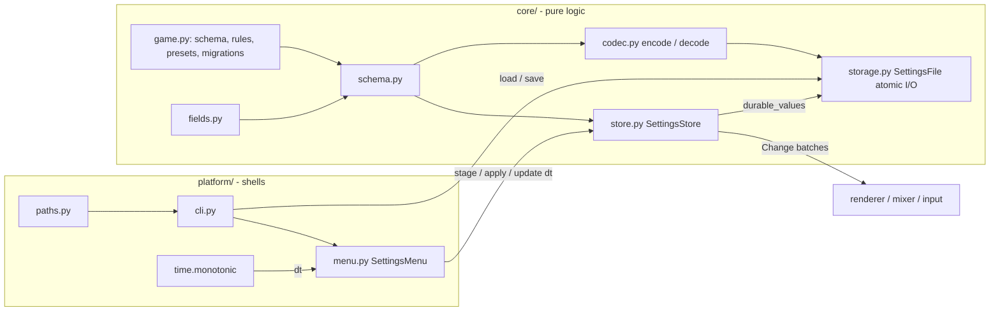

# 017 — Game Settings System

> The options menu every game ships, built properly: typed, schema-validated settings with defaults, quality presets, a "keep these display settings?" countdown, versioned save-file migrations, and crash-safe atomic persistence.

**Stack:** Python · **Level:** Starter · **Track:** Foundations

## What it is

A reusable settings engine (graphics, audio, controls) plus two front ends: a text-mode options menu that behaves like a pause-menu UI, and a `gamesettings` CLI for scripting. No third-party dependencies.

```
SETTINGS   [1] GRAPHICS  [2] Audio  [3] Controls
Preset: custom · renders at 2560x1440

>* Resolution           2560x1440    ◄ ► [confirm]
   Window mode          borderless       [confirm]
   V-Sync               on
   FPS limit            0
   Render scale         1
   Texture quality      high             [restart]
   ...
  Keep these display settings? Reverting in 12s  [y] keep  [n] revert
  tabs: 1-3 · move: j/k · adjust: h/l or -/+ · type a value: = VALUE · a apply · d discard · r reset tab · p PRESET · q quit
```

Behind it is a settings file that only stores what you changed:

```json
{
  "version": 2,
  "settings": {
    "graphics": { "resolution": "2560x1440", "texture_quality": "ultra" },
    "controls": { "bind_jump": "F" }
  }
}
```

## Gaming technique

Settings look trivial until they ship. Then they get hand-edited, carried across patches, hit by power cuts mid-write, and changed by players who pick a resolution their monitor can't show. Here is how this project handles each of those:

- **Typed fields with a schema.** Each option is a field (`BoolField`, `IntField`, `FloatField`, `ChoiceField`, `ResolutionField`, `KeyField`). The field has a default, a range or choice list, a label, and flags. The schema is the one place a designer adds an option, and the menu, CLI, file format, and validation all come from it. The defaults are checked when the schema is built, so a bad default fails at startup instead of reaching players.
- **Cross-field rules.** Some rules span more than one setting: no two actions bound to the same key, and an FPS cap of 0 (uncapped) or at least 30. The store checks these against the *merged* staged + live values when you apply. That means swapping Jump and Interact in one apply works, even though each half on its own would collide.
- **Stage → Apply → (Confirm).** As in most PC games, sliders change a *pending* copy that the menu previews. **Apply** commits it and notifies listeners (the renderer, the mixer). **Discard** or **Back** throws it away.
- **Keep-or-revert countdown.** A resolution or window-mode change can leave the player with a black screen and no way to click "undo". So those fields are marked `needs_confirmation`. Applying one makes it live but starts a 15-second timer, driven by `update(dt)`. If nobody confirms, it reverts. `durable_values` (what gets saved) keeps returning the *old* values until you confirm, so a crash during the countdown boots back into a working mode. Windows' own display settings and most PC games do the same thing.
- **Restart-required flags.** Some options (texture pool size, here `texture_quality`) only take effect after a restart. `ApplyResult.restart_required` tells the UI to say so.
- **Derived quality presets.** Low/Medium/High/Ultra set several options at once. The current preset is *computed* from the values (`detect_preset`) and never stored, so it can't disagree with them. Change one option and the menu shows "custom", as in most PC games.
- **Diff-from-defaults persistence.** Only non-default values are written. Files stay tiny and readable, and if a patch improves a default, every player who never touched that option gets the new one.
- **Forgiving loads.** A bad value never costs the player the rest of their setup:
  - An out-of-range number is *clamped* (FOV 130 → 120 after a patch lowers the max).
  - A malformed value falls back to its default.
  - Unknown keys are dropped.
  - If a binding conflicts, only the player-changed side is reset.

  Every repair comes back as a warning in a `LoadReport`. If the whole file is unparseable, it is moved aside to `settings.json.corrupt` and the game boots on defaults. `load()` never raises.
- **Versioned migrations.** Version 1 had a `fullscreen` checkbox and a 0–1 `volume`. Version 2 has a three-way `window_mode` and percentage volumes. Each migration upgrades raw data by exactly one version, and the steps chain (1→2→3…). A migration translates the shapes it recognizes and carries anything odd forward, and normal validation then reports it under the new key.
- **Atomic writes.** Save writes a temp file in the same directory, `fsync`s it, then `os.replace`s it over the original. The replace is atomic on POSIX and Windows, so the file is always either the old version or the new one, never half-written.
- **Per-OS location.** `%APPDATA%` on Windows, `~/Library/Application Support` on macOS, and `$XDG_CONFIG_HOME` (or `~/.config`) on Linux.
- **What the engine reads.** `effective_volume()` (master × channel, muted when unfocused), `render_resolution()` (output × render scale, rounded to even sizes for upscalers), and `bindings()`.

## Software engineering concepts

- **Schema-driven design (single source of truth).** Validation, the menu, the CLI, the file format and defaults all read the same `Schema`. Adding a setting is one line in `core/game.py`.
- **Strategy-like field types.** Each field type implements `coerce` / `parse` / `step` / `format`. The store and menu never branch on type, so a new type (say a colour picker) plugs in without touching them.
- **Observer.** `subscribe()` returns an unsubscribe function. Listeners get one batch of `Change(key, old, new)` per apply or revert, so a renderer can rebuild its swapchain once, not once per setting.
- **Small state machine.** The store is either *settled* or *awaiting confirmation*. Illegal moves (editing during the countdown, confirming when nothing is pending) raise `StateError` rather than silently doing something odd.
- **Pure core, thin shells.** `core/` has no terminal or OS-path code, and the codec does no I/O at all. Time is injected as `dt` through `update()`, and the menu's `run()` takes a clock function, so tests fast-forward the 15-second countdown in microseconds. `paths.py` is a pure function of `(platform, env, home)`, so all three OSes are tested from one.
- **Robustness principle at the boundary.** The code is strict about what it saves and lenient about what it loads. A seeded fuzz test decodes 2,000 random JSON documents, including NaN, Infinity, nested junk and duplicate bindings, and asserts that every result is complete, rule-abiding and canonical.
- **Typed error hierarchy.** `ValidationError`, `UnknownSettingError` (which suggests close matches: "did you mean graphics.vsync?"), `RuleViolationError`, `StateError` and `CorruptSettingsError` all derive from `SettingsError`, so callers catch as broadly or narrowly as they need. The CLI maps them to exit codes (2 = bad input, 1 = could not save).

**Trade-offs**
- *Diff-only saves vs. full snapshots.* Diffs pick up improved defaults automatically, but a player can't "pin" a value equal to today's default against a future change. Shipped games split both ways. A full snapshot is safer for competitive settings like sensitivity.
- *Clamp vs. reset on load.* Clamping keeps intent ("as wide as possible") for numbers, but there is no sensible clamp for a choice or a key, so those reset. Either way the player sees a warning rather than a silent change.
- *Flat dotted keys vs. nested objects.* Flat keys make diffing, migrations and lookups trivial. The cost is a nesting step in the codec and a two-level limit (section.name).
- *JSON vs. INI/TOML.* JSON is in the standard library and unambiguous, but it has no comments for hand-editors. TOML would read better, but Python can only read it without a dependency, not write it.
- *Text menu vs. real UI.* The menu is line-based so it can be scripted in tests. A real game would feed the same `SettingsMenu.handle` commands from controller input and draw `render()`'s model with its UI toolkit.

## Architecture



```
 stage/adjust ──► pending ──apply()──► live ──► listeners
                    │                    │
               discard()         risky? ─┴─► awaiting ──confirm()──► durable
                                             │  revert() / timeout
                                             └──────────► previous live
```

## Build, run, and test

```bash
python -m venv .venv && source .venv/bin/activate
pip install -e ".[dev]"

gamesettings menu                               # interactive options menu
gamesettings show                               # all settings, * = changed
gamesettings set graphics.vsync=off audio.music_volume=40%
gamesettings preset low
gamesettings get controls.bind_jump
gamesettings reset audio.music_volume
gamesettings --config ./my-settings.json show   # use any file
gamesettings path                               # where the default file lives

pytest                                          # 133 tests
```

Without installing: `PYTHONPATH=src python -m gamesettings show`.

## Project structure

```
src/gamesettings/
├── core/
│   ├── errors.py     # SettingsError hierarchy and Violation
│   ├── fields.py     # Bool/Int/Float/Choice/Resolution/Key fields: coerce, parse, step, format
│   ├── schema.py     # Schema (dotted keys, sections, rules) and the unique_values rule
│   ├── store.py      # SettingsStore: staging, apply, observers, confirm/revert countdown
│   ├── codec.py      # JSON encode (diff from defaults) and forgiving decode with migrations
│   ├── storage.py    # SettingsFile: atomic save, corrupt-file quarantine
│   └── game.py       # this game's schema, v1→v2 migration, presets, derived values
├── platform/
│   ├── paths.py      # per-OS config path
│   ├── menu.py       # text-mode options menu and its input loop
│   └── cli.py        # argparse front end
└── __main__.py
tests/                # fields, schema, store, codec (incl. seeded fuzz), storage, game, paths, menu, CLI
```

## Possible extensions

- **Layered sources:** defaults ← platform profile (Steam Deck, console) ← user file ← command-line overrides, with each value reporting which layer it came from
- **Hardware auto-detect:** pick a starting preset from a benchmark or GPU tier on first launch
- **Per-profile settings** (several local players) and cloud sync with conflict resolution
- **Rebinding UI** that listens for the next key press and offers to swap when a key is already taken
- **Accessibility section** (colour-blind filters, text size, hold-to-toggle) with live preview through the observer
- **Hook it into a real loop:** subscribe the renderer and mixer from project 001's Pong and apply changes live
