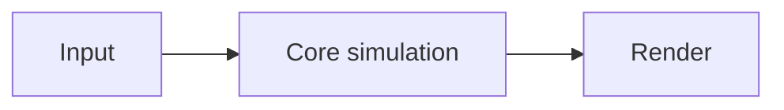

# NNN — Project Title

> One-line pitch.

**Stack:** … · **Level:** … · **Track:** …

## What it is

Short description and a screenshot or ASCII sketch of the game or demo.

## Gaming technique

How the feature works, why games use it, and where it shows up in shipped games.

## Software engineering concepts

- **Concept/pattern:** where it appears in this code and why it was chosen
- **Trade-offs:** what the design costs and what the alternatives were

## Architecture



## Build, run, and test

```bash
# install
# run
# test
```

## Project structure

```
src/
tests/
```

## Possible extensions

- …
